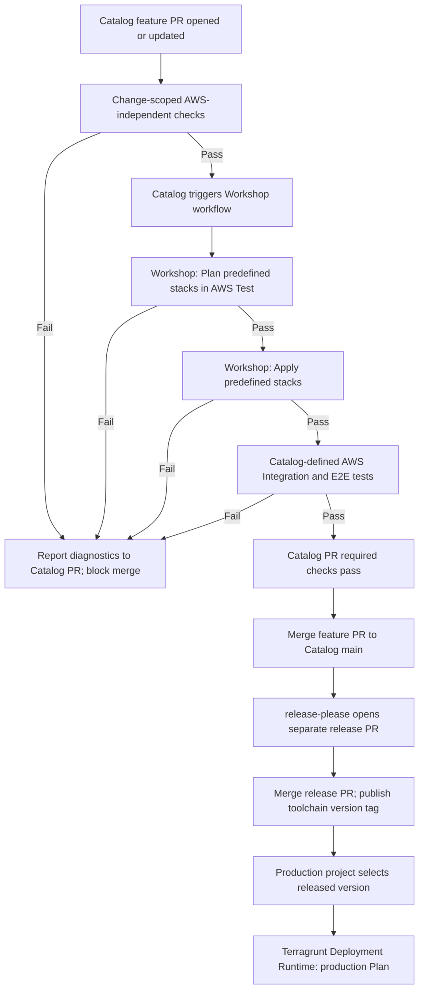

# 3. Solution

The proposed solution introduces automated, layered testing for the Terragrunt toolchain, integrated into the existing GitHub Actions CI/CD process.

The **Catalog repository** is the central entry point for testing. Every pull request targeting `main`, including subsequent updates, triggers a validation pipeline combining change-scoped, AWS-independent checks with a fixed set of infrastructure tests in a dedicated AWS Test environment.

Two complementary approaches are used:

- **Change-scoped validation:** AWS-independent code checks run against the affected validation units identified from the Catalog PR diff. They do not access AWS.
- **Fixed infrastructure testing:** The same predefined AWS test scenarios run for every Catalog PR, regardless of which files or components changed.

Catalog owns test definitions, orchestration, reporting, and the PR quality gate. The **Terragrunt Deployment Workshop** repository performs Plan and Apply for the candidate toolchain against AWS Test. All mandatory stages must pass before the Catalog feature PR is eligible for merge.

## 3.1. Testing Strategy and Layers

The testing strategy combines configuration correctness, security and policy compliance, planned infrastructure changes, actual AWS behavior, and critical end-to-end workflows.

| Testing Layer | Purpose | Proposed Tooling | Execution Scope |
|---|---|---|---|
| **Static Validation** | Validate Terragrunt/Terraform syntax, formatting, structure, inherited settings, and generated configuration where applicable. | Terragrunt HCL validation, Terraform fmt/validate, TFLint | Catalog PR, affected validation units; no AWS access |
| **Native Module Tests** | Check expected module behavior and assertions where applicable. | Terraform Test (`.tftest.hcl`), using AWS-independent test modes/mocks | Catalog PR, affected testable modules; no AWS access |
| **IaC Security & Policy** | Detect misconfigurations and enforce predefined policies. | Checkov / Trivy, OPA / Conftest | Catalog PR, affected validation units; no AWS access |
| **Terragrunt Plan Validation** | Verify that predefined stacks produce valid infrastructure plans using the candidate toolchain. | Terragrunt Plan, Terraform plan JSON analysis | Workshop, fixed test stacks in AWS Test |
| **AWS Integration Tests** | Verify actual AWS resource behavior, permissions, and cross-component interactions. | Terratest, AWS SDK | Catalog-defined fixed suite, against deployed AWS Test infrastructure |
| **Limited Stack E2E** | Validate critical infrastructure workflows spanning multiple components. | Terratest, GitHub Actions | Catalog-defined fixed suite, against deployed AWS Test infrastructure |

AWS-independent checks must not require AWS credentials, remote state access, or live provider operations. Any validation that needs AWS is assigned to the Workshop/AWS testing stages. Selecting checks from a diff does not mean running them on isolated diff lines: each tool receives the full configuration context needed for the affected validation unit.

## 3.2. High-Level Architecture

| Component | Responsibility |
|---|---|
| **Catalog Repository** | Stores the versioned Terragrunt toolchain and test definitions; initiates and coordinates validation; executes AWS-independent and Catalog-defined runtime tests; owns PR status and quality gates. |
| **Terragrunt Deployment Workshop** | Receives a candidate revision from Catalog and performs Terragrunt Plan and Apply for predefined stacks in the dedicated AWS Test account. |
| **Terragrunt Deployment Runtime** | Performs infrastructure Plan operations for the production organization using a released toolchain version selected by the consuming project. |

Catalog coordinates the cross-repository workflow, waits for Workshop deployment results, and then runs its integration and E2E tests against the provisioned environment. The mechanism used to reference the candidate Catalog revision before a release tag exists is intentionally deferred to detailed design.

## 3.3. CI/CD Testing and Release Flow

1. **Catalog PR validation:** On PR creation or update, Catalog runs AWS-independent static, applicable module, and IaC security/policy checks against affected validation units. Failure stops progression to dependent stages and surfaces diagnostic information on the PR.
2. **Workshop infrastructure deployment:** After dry checks pass, Catalog triggers Workshop with the candidate toolchain revision. Workshop runs Plan and Apply for predefined test stacks in AWS Test. The test stacks are not selected based on the PR diff.
3. **AWS runtime verification:** Following successful Apply, Catalog runs its predefined integration and limited E2E tests against the deployed infrastructure. The same suite runs for each PR.
4. **Catalog PR quality gate:** Mandatory results are consolidated into required PR checks. Any failed mandatory stage blocks merge.
5. **Toolchain version release:** After the feature PR merges into Catalog/main, the existing release-please process opens a separate release PR for the version and changelog. Merging that PR publishes the new version tag.
6. **Production consumption:** A production project references the released toolchain version in its Terragrunt configuration. The existing process propagates that selection to Terragrunt Deployment Runtime, which generates the production organization Plan. Production Apply and its approvals are outside this solution's scope.

## 3.4. AWS Test Environment

The dedicated AWS Test account provides an isolated environment for verifying candidate toolchain behavior before release.

| Principle | High-Level Design |
|---|---|
| **Isolation** | Keep test infrastructure and permissions separate from production. |
| **Representative coverage** | Deploy predefined stacks covering critical toolchain capabilities and infrastructure interactions. |
| **Version consistency** | Use the same candidate Catalog revision for Workshop deployment and Catalog-defined runtime verification. |
| **Concurrent execution** | Prevent concurrent PR runs from interfering with shared resources or test results. |
| **Lifecycle management** | Return test resources to a controlled state after execution, including failed runs. |
| **Restricted access** | Limit deployment and verification permissions to the AWS Test environment and required actions. |

Specific resource isolation, reuse, concurrency, and cleanup mechanisms belong in the low-level design.

## 3.5. Quality Gates and Test Results

Catalog is the single point of visibility for testing status. The workflow uses sequential **fail-fast stage gates**: failure of a mandatory stage prevents dependent stages from starting. Independent checks within a stage may finish to provide a consolidated diagnostic report.

| Quality Gate | Success Criteria | Failure Behavior |
|---|---|---|
| **Code Validation** | All applicable AWS-independent checks pass. | Stop progression; report failed checks on Catalog PR. |
| **Infrastructure Plan** | Predefined Workshop test stacks produce successful plans. | Do not Apply; report failure to Catalog. |
| **Infrastructure Apply** | Test infrastructure is provisioned successfully. | Do not start runtime verification; report failure. |
| **Runtime Verification** | All mandatory AWS Integration and E2E tests pass. | Block Catalog feature PR merge. |
| **Final PR Gate** | All required stages complete successfully. | Mark Catalog PR checks as passing and permit merge eligibility. |

Each run must identify the originating Catalog PR, candidate revision, executed checks, stage outcomes, and relevant error messages or diagnostic artifacts. Required GitHub checks enforce the Catalog feature PR merge gate.

## 3.6. Phase 1 Scope and Future Evolution

| Capability | Phase 1: Testing Foundation | Phase 2: Advanced Testing |
|---|---|---|
| **Test Coverage** | Baseline code checks and fixed critical AWS scenarios. | Broader stack and dependency coverage. |
| **Code Validation** | Diff-scoped selection of affected validation units, with full context for each check. | More precise change-impact analysis. |
| **AWS Test Selection** | Same predefined test suite for every Catalog PR. | Dependency-aware, risk-based Test Impact Analysis. |
| **Test Execution** | Sequential automated validation and runtime verification. | Execution optimization and test prioritization. |
| **Quality Gates** | Mandatory checks before feature PR merge. | Risk-informed gates and coverage assessment. |
| **Test Visibility** | Centralized PR results and diagnostic evidence. | Impact traceability and coverage insights. |

Phase 1 does **not** implement dynamic AWS test selection, a dependency graph, or discovery of implicit AWS resource dependencies. These capabilities are potential Phase 2 extensions.

## Design Considerations

- **Pre-release candidate:** Workshop must consume the proposed Catalog revision before a version tag exists. The exact reference mechanism remains a detailed-design decision.
- **Release integrity:** Because release-please creates a separate release PR, the released toolchain content must remain equivalent to the validated content, or relevant validation must be repeated for the final release candidate.
- **AWS-independent validation:** Some Terraform validation commands can access providers or state depending on how they are used. Only genuinely offline checks belong in the Catalog dry-check stage.
- **Runtime test execution:** Test definitions and orchestration remain in Catalog; the execution environment must have appropriately restricted access to AWS Test.

## References

- [GitHub Actions documentation](https://docs.github.com/en/actions)
- [Terraform validate](https://developer.hashicorp.com/terraform/cli/commands/validate)
- [Terraform plan](https://developer.hashicorp.com/terraform/cli/commands/plan)
- [Terraform test](https://developer.hashicorp.com/terraform/cli/commands/test)
- [release-please](https://github.com/googleapis/release-please)
