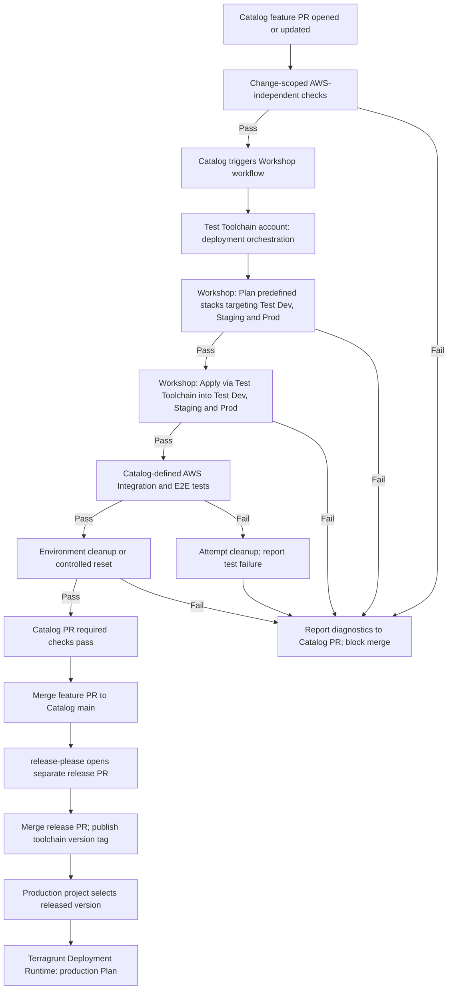
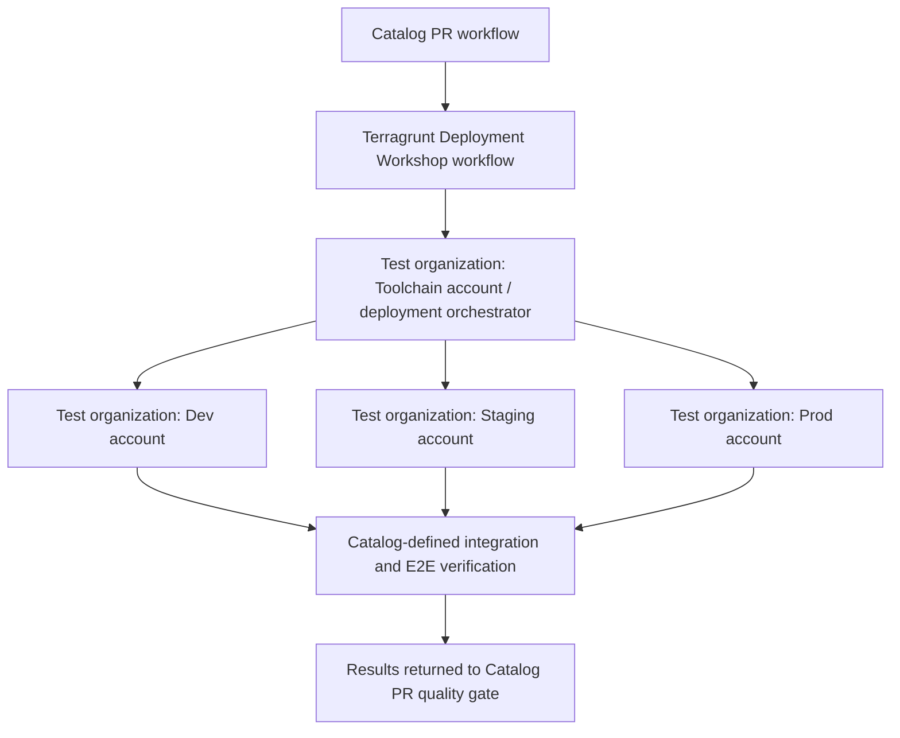

# Terragrunt Toolchain Automated Testing - High-Level Design

**Status:** Draft for architecture review  
**Scope:** Phase 1 testing foundation and future evolution  
**Decision status:** Four-account AWS Test topology confirmed; resource lifecycle, IAM implementation, cost and approvals remain open

# 3. Solution

The proposed solution introduces automated, layered testing for the Terragrunt toolchain, integrated into the existing GitHub Actions CI/CD process.

The **Catalog repository** is the central entry point for testing. Every pull request targeting `main`, including subsequent updates, triggers a validation pipeline combining change-scoped, AWS-independent checks with a fixed set of infrastructure tests in a dedicated AWS Test environment.

Two complementary approaches are used:

- **Change-scoped validation:** AWS-independent code checks run against the affected validation units identified from the Catalog PR diff. They do not access AWS.
- **Fixed infrastructure testing:** The same predefined AWS test scenarios run for every Catalog PR, regardless of which files or components changed.

Catalog owns test definitions, orchestration, reporting, and the PR quality gate. The **Terragrunt Deployment Workshop** repository performs Plan and Apply for the candidate toolchain through the Test Toolchain orchestration account into the Test Dev, Staging and Prod accounts. All mandatory stages must pass before the Catalog feature PR is eligible for merge.

## 3.1. Testing Strategy and Layers

The testing strategy combines configuration correctness, security and policy compliance, planned infrastructure changes, actual AWS behavior, and critical end-to-end workflows.

| Testing Layer | Purpose | Proposed Tooling | Execution Scope |
|---|---|---|---|
| **Static Validation** | Validate Terragrunt/Terraform syntax, formatting, structure, inherited settings, and generated configuration where applicable. | Terragrunt HCL validation, Terraform fmt/validate, TFLint | Catalog PR, affected validation units; no AWS access |
| **Native Module Tests** | Check expected module behavior and assertions where applicable. | Terraform Test (`.tftest.hcl`), using AWS-independent test modes/mocks | Catalog PR, affected testable modules; no AWS access |
| **IaC Security & Policy** | Detect misconfigurations and enforce predefined policies. | Checkov / Trivy, OPA / Conftest | Catalog PR, affected validation units; no AWS access |
| **Terragrunt Plan Validation** | Verify that predefined stacks produce valid infrastructure plans using the candidate toolchain. | Terragrunt Plan, Terraform plan JSON analysis | Workshop via the Test Toolchain account, fixed test stacks targeting Test Dev/Staging/Prod |
| **AWS Integration Tests** | Verify actual AWS resource behavior, permissions, and cross-component interactions. | Terratest, AWS SDK | Catalog-defined fixed suite, against infrastructure deployed into the Test Dev/Staging/Prod accounts |
| **Limited Stack E2E** | Validate critical infrastructure workflows spanning multiple components. | Terratest, GitHub Actions | Catalog-defined fixed suite, against infrastructure deployed into the Test Dev/Staging/Prod accounts |

AWS-independent checks must not require AWS credentials, remote state access, or live provider operations. Any validation that needs AWS is assigned to the Workshop/AWS testing stages. Selecting checks from a diff does not mean running them on isolated diff lines: each tool receives the full configuration context needed for the affected validation unit.

## 3.1.1. Test Coverage and Representative Scenarios

The Phase 1 test coverage targets **both candidate Catalog toolchain compatibility and actual AWS infrastructure behavior**. The scenarios below describe intended validation outcomes, not individual test cases or implementation steps. Final test fixtures and assertions belong in the LLD/Test Catalog.

| Testing Layer | Representative Phase 1 Scenarios | Selection and Execution |
|---|---|---|
| **Static Validation** | Validate HCL syntax and formatting; Terragrunt inheritance and required inputs; generated provider/backend configuration where offline verification is possible. | Catalog PR: select affected validation units from the diff, then validate each with the necessary full configuration context; no AWS access. |
| **Native Module Tests** | Validate module input contracts, expected outputs and configuration invariants **where Catalog changes affect testable modules**. | Catalog PR: affected testable modules; offline test modes or mocks only. |
| **IaC Security & Policy** | Detect prohibited IAM permissions and trust-policy patterns, unsafe network exposure, missing required encryption and organization policy violations in changed configurations. | Catalog PR: affected validation units; no AWS access. |
| **Terragrunt Plan Validation** | Generate valid plans using the candidate toolchain for predefined stacks targeting **Test Dev, Test Staging and Test Prod** through the **Test Toolchain orchestration account**; check expected plan characteristics. | Workshop: fixed representative stacks on every Catalog PR; AWS Test access permitted. |
| **AWS Integration Tests** | Verify authorized cross-account role assumption from Toolchain to target accounts; rejection of unauthorized access; effective permission-boundary restrictions; isolation between target accounts; expected deployed resource properties and cross-resource interactions. | Catalog-owned fixed runtime suite against Workshop-deployed AWS Test infrastructure on every PR. |
| **Limited Stack E2E** | Validate a representative end-to-end workflow from candidate Catalog revision through Workshop Plan/Apply and Toolchain orchestration to successful resource verification in target account(s). | Catalog-owned fixed critical scenarios against AWS Test on every PR. |

**Phase 1 coverage boundaries**

- AWS-independent checks are **change-scoped**, not restricted to isolated diff lines; shared configuration changes may require validation of dependent configuration units.
- AWS Plan, Integration and E2E scenarios are **fixed for every PR**, independent of the changed Catalog files. This is not Phase 1 Test Impact Analysis.
- The **Toolchain** account orchestrates deployment into the separate **Dev, Staging and Prod** accounts **inside the Test organization**. Test Prod is not real production.
- Coverage demonstrates representative toolchain capabilities and critical AWS behaviors; it does not guarantee exhaustive production-stack compatibility or organization-wide compliance.
- **Deployment lifecycle testing** (upgrade/update behavior, idempotency assertions, and destroy correctness as test scenarios) is **excluded from Phase 1**. Workshop must still perform the Plan/Apply operations required to provision test fixtures, and the platform must still manage cleanup or reset operationally under the selected lifecycle model.
- Dynamic AWS test selection, dependency graph construction, and risk-based Test Impact Analysis are deferred to Phase 2.

## 3.2. High-Level Architecture

| Component | Responsibility |
|---|---|
| **Catalog Repository** | Stores the versioned Terragrunt toolchain and test definitions; initiates and coordinates validation; executes AWS-independent and Catalog-defined runtime tests; owns PR status and quality gates. |
| **Terragrunt Deployment Workshop** | Receives a candidate revision from Catalog and initiates Terragrunt Plan and Apply through the Toolchain orchestration account, targeting the Dev, Staging and Prod environment accounts in the isolated AWS Test organization. |
| **Terragrunt Deployment Runtime** | Performs infrastructure Plan operations for the production organization using a released toolchain version selected by the consuming project. |

Catalog coordinates the cross-repository workflow. Workshop uses the Test Toolchain account as the deployment orchestrator to target the separate Test Dev, Staging and Prod accounts. After deployment, Catalog runs its integration and E2E tests against resources in those target accounts. The Test Prod account is not the real production account. The mechanism used to reference the candidate Catalog revision before a release tag exists is intentionally deferred to detailed design.

## 3.3. CI/CD Testing and Release Flow

1. **Catalog PR validation:** On PR creation or update, Catalog runs AWS-independent static, applicable module, and IaC security/policy checks against affected validation units. Failure stops progression to dependent stages and surfaces diagnostic information on the PR.
2. **Workshop infrastructure deployment:** After dry checks pass, Catalog triggers Workshop with the candidate toolchain revision. Workshop runs Plan and Apply via the Toolchain orchestration account, deploying predefined test stacks into the separate Dev, Staging and Prod accounts of the AWS Test organization. The test stacks are not selected based on the PR diff.
3. **AWS runtime verification:** Following successful Apply, Catalog runs its predefined integration and limited E2E tests against the deployed infrastructure. The same suite runs for each PR.
4. **Environment finalization:** Following runtime verification, Workshop/Catalog coordinates cleanup or reset according to the selected lifecycle model. Cleanup is also attempted after failed deployment or testing; cleanup failures are reported.
5. **Catalog PR quality gate:** Mandatory results are consolidated into required PR checks. Any failed mandatory stage blocks merge.
6. **Toolchain version release:** After the feature PR merges into Catalog/main, the existing release-please process opens a separate release PR for the version and changelog. Merging that PR publishes the new version tag.
7. **Production consumption:** A production project references the released toolchain version in its Terragrunt configuration. The existing process propagates that selection to Terragrunt Deployment Runtime, which generates the production organization Plan. Production Apply and its approvals are outside this solution's scope.

## 3.4. AWS Test Environment

The AWS Test organization uses **four distinct AWS accounts**. The **Toolchain account** is the central orchestration account: it coordinates infrastructure deployments into the three environment accounts, **Dev**, **Staging**, and **Prod**. The three environment accounts are deployment targets, not three independent toolchain orchestrators. All four accounts are within the isolated **Test organization**; its **Prod** account must not be confused with the real production organization's accounts.

Thunder is responsible for provisioning the required account setup in the Test organization. The four-account topology and orchestration responsibilities are confirmed; the exact IAM trust model and resource lifecycle remain open.

| Account | Role in Test Organization | Responsibility |
|---|---|---|
| **Toolchain** | Central deployment orchestrator | Initiates/coordinates Terragrunt Plan and Apply for predefined stacks in the target environment accounts, using approved cross-account permissions. |
| **Dev** | Deployment target | Hosts the predefined Dev test infrastructure and its runtime verification targets. |
| **Staging** | Deployment target | Hosts the predefined Staging test infrastructure and its runtime verification targets. |
| **Prod** | Deployment target (test only) | Hosts the predefined Prod-like test infrastructure; isolated from real production accounts. |

| Principle | High-Level Design |
|---|---|
| **Isolation** | Keep Toolchain and all three target environment accounts inside the Test organization, separate from the real production organization. |
| **Deployment path** | Workshop deploys through the Test Toolchain account, which orchestrates deployment into Test Dev, Staging and Prod. |
| **Lifecycle flexibility** | Keep persistent reusable resources, per-run Plan → Apply → Test → Destroy, and hybrid approaches under evaluation. |
| **Representative coverage** | Run a fixed set of test stacks and runtime scenarios across the three target accounts for each Catalog PR. |
| **Version consistency** | Use the same candidate Catalog revision for Workshop deployment and Catalog-defined runtime verification. |
| **Concurrent execution** | Prevent concurrent PR runs from interfering with resources across any of the four accounts. |
| **Lifecycle management** | Return resources in target accounts to a controlled state after execution, including failed runs; preserve orchestration controls as appropriate. |
| **Restricted access** | Scope Toolchain-to-environment cross-account permissions and verification access to approved Test accounts and operations. |

Specific resource isolation, reuse, concurrency, and cleanup mechanisms belong in the low-level design. If per-run teardown is chosen, cleanup must execute after both successful and failed tests, and teardown failures must remain visible in the Catalog PR results.

## 3.5. Quality Gates and Test Results

Catalog is the single point of visibility for testing status. The workflow uses sequential **fail-fast stage gates**: failure of a mandatory stage prevents dependent stages from starting. Independent checks within a stage may finish to provide a consolidated diagnostic report.

| Quality Gate | Success Criteria | Failure Behavior |
|---|---|---|
| **Code Validation** | All applicable AWS-independent checks pass. | Stop progression; report failed checks on Catalog PR. |
| **Infrastructure Plan** | Predefined Workshop test stacks produce successful plans. | Do not Apply; report failure to Catalog. |
| **Infrastructure Apply** | Test infrastructure is provisioned successfully. | Do not start runtime verification; report failure. |
| **Runtime Verification** | All mandatory AWS Integration and E2E tests pass. | Block Catalog feature PR merge. |
| **Environment Finalization (operational)** | Cleanup/reset completes according to the selected lifecycle policy, with failures reported; this is not a deployment lifecycle test. | Report leaked resources; block merge where finalization is mandatory. |
| **Final PR Gate** | All required stages complete successfully. | Mark Catalog PR checks as passing and permit merge eligibility. |

Each run must identify the originating Catalog PR, candidate revision, executed checks, stage outcomes, and relevant error messages or diagnostic artifacts. Required GitHub checks enforce the Catalog feature PR merge gate.

## 3.6. Phase 1 Scope and Future Evolution

| Capability | Phase 1: Testing Foundation | Phase 2: Advanced Testing |
|---|---|---|
| **Test Coverage** | Baseline code checks and fixed critical AWS scenarios. | Broader stack and dependency coverage. |
| **Code Validation** | Diff-scoped selection of affected validation units, with full context for each check. | More precise change-impact analysis. |
| **AWS Test Selection** | Same predefined test suite for every Catalog PR. | Dependency-aware, risk-based Test Impact Analysis. |
| **Test Execution** | Sequential automated validation and runtime verification. | Execution optimization and test prioritization. |
| **Quality Gates** | Mandatory checks before feature PR merge. | Risk-informed gates and coverage assessment. |
| **Test Visibility** | Centralized PR results and diagnostic evidence. | Impact traceability and coverage insights. |

Phase 1 does **not** include deployment lifecycle tests (update, idempotency, destroy correctness), dynamic AWS test selection, a dependency graph, or discovery of implicit AWS resource dependencies. These capabilities are potential Phase 2 extensions.

## 3.7. Design Considerations

- **Pre-release candidate:** Workshop must consume the proposed Catalog revision before a version tag exists. The exact reference mechanism remains a detailed-design decision.
- **Release integrity:** Because release-please creates a separate release PR, the released toolchain content must remain equivalent to the validated content, or relevant validation must be repeated for the final release candidate.
- **AWS-independent validation:** Some Terraform validation commands can access providers or state depending on how they are used. Only genuinely offline checks belong in the Catalog dry-check stage.
- **Runtime test execution:** Test definitions and orchestration remain in Catalog; the execution environment must have appropriately restricted access to AWS Test.

# 4. Alternatives Considered

The following alternatives were assessed against release safety, repository ownership, four-account orchestration, operational complexity, and cost. The selected approach for orchestration is described in Section 3. Environment lifecycle remains undecided.

| Design Area | Alternative | Assessment / Why Not Selected |
|---|---|---|
| Test orchestration | **Catalog-driven workflow with Workshop deployment** | **Selected for Phase 1.** Catalog controls the release gate and test definitions; Workshop retains infrastructure deployment responsibilities. |
| Test orchestration | Workshop-only testing after a version is released | Not selected: failures would be discovered after the Catalog version becomes available, weakening pre-release validation. |
| Test orchestration | Run all AWS deployment and tests directly from Catalog | Not selected: duplicates Workshop deployment responsibilities and increases coupling between Catalog CI and AWS deployment permissions. |
| AWS test selection | Fixed AWS suites on every PR | **Selected for Phase 1.** Predictable baseline coverage without a dependency-selection engine. |
| AWS test selection | Dynamic dependency-aware test selection | Deferred to Phase 2: requires dependency mapping, risk rules, and additional engineering and validation. |
| Environment lifecycle | **Persistent reusable test resources in target accounts** | **Open.** Reduces repeated provisioning time but introduces shared-state drift, concurrency collisions, and ongoing resource costs. |
| Environment lifecycle | **Ephemeral target-account resources per test run** | **Open.** Improves repeatability and isolation, but adds provisioning time, teardown complexity, and potential transient resource costs. |
| Environment lifecycle | Hybrid: persistent Toolchain foundation with ephemeral target-account test stacks | **Open.** May balance speed and isolation, but requires clear ownership and boundaries between shared and disposable resources. |

**Lifecycle decision criteria:** ability to reproduce critical test scenarios; AWS resource creation/destruction constraints; runtime and cost; test isolation; cleanup reliability; and support for the Toolchain orchestrator and its three target environment accounts within the Test organization.

# 5. Security, Cost, and Operations

## 5.1. Security / IAM

- **Trust boundary:** Catalog initiates testing; Workshop performs AWS Test Plan/Apply; Catalog-defined runtime tests receive only the access needed to verify deployed resources.
- **Environment isolation:** All test actions remain in the Test organization. Its Toolchain orchestrator and Dev, Staging and Prod target accounts are separate from the real production organization; Test Prod is not production.
- **Least privilege:** Use dedicated CI and Toolchain orchestration roles with narrowly scoped permissions for deployment, verification, and cleanup. Toolchain-to-Dev/Staging/Prod role assumption must be explicitly authorized and bounded; avoid unrestricted cross-account role assumption.
- **Credential handling:** Prefer short-lived federated credentials (for example, GitHub OIDC to AWS) over long-lived access keys. Protect secrets and restrict access to trusted workflows.
- **PR safety:** Candidate code is untrusted until validated. Separate permissions for code-only checks from AWS-enabled stages; do not expose production credentials to PR code.
- **Auditability:** Attribute AWS actions to the Catalog PR/run and the initiating workflow, and retain relevant IAM and deployment audit events.
- **Policy boundaries:** Explicitly validate permitted Toolchain-to-target-account deployment operations and denied unauthorized cross-account operations as part of the fixed integration suite.

The four-account topology is confirmed. Exact roles, trust policies, permission boundaries, and verification identities remain detailed-design decisions requiring security review.

## 5.2. Cost (USD)

**Estimated implementation cost: TBD USD.**  
**Estimated recurring AWS test cost: TBD USD/month.**  
**Estimated CI/runner cost: TBD USD/month.**

No dollar amounts are assigned until the AWS test topology, representative resources, lifecycle model, execution frequency, and runner billing model are confirmed.

| Cost Component | Estimation Basis | Amount (USD) |
|---|---|---|
| AWS test resources | Resource inventory and active hours across the Test Toolchain orchestration account and the Test Dev/Staging/Prod target accounts | TBD / month |
| Provisioning and runtime tests | Expected PR runs × average test duration × metered services | TBD / month |
| GitHub Actions / CodeBuild runners | Runner minutes, CodeBuild compute, artifact storage | TBD / month |
| Networking and data transfer | NAT, endpoints, cross-AZ traffic, logging ingestion where applicable | TBD / month |
| Observability and retention | CloudWatch logs/metrics, artifact retention, audit logs | TBD / month |
| Cleanup failures / idle resources | Allowance based on orphan-resource and lifecycle risk | TBD / month |
| Initial engineering | Workflow integration, test implementation, IAM, environment setup | TBD one-time |

**Cost model:** Monthly cost = baseline always-on infrastructure + (PR runs per month × incremental execution cost per run) + logging/storage/network overhead. For an ephemeral design, baseline infrastructure may be lower while provisioning and teardown costs become more significant. Compare both models using the same test suite and expected PR volume before choosing a lifecycle.

**Cost controls:** apply mandatory resource tags, budgets and alerts, retention limits, time-to-live/cleanup controls, and a periodic orphan-resource review. Establish a pilot budget threshold before enabling broad PR execution.

## 5.3. Observability

The **Catalog PR** is the primary user-facing status and diagnostic surface. The solution should provide:

- A single correlated run identity linking Catalog PR, candidate revision, Workshop workflow, AWS deployment, and runtime test results.
- Per-stage status, elapsed time, and failure reason, including explicit identification of skipped downstream stages.
- Access to Plan/Apply diagnostics, security findings, integration/E2E reports, and cleanup outcomes, with sensitive values redacted.
- Operational indicators for success rate, run duration, flaky tests, resource cleanup failures, and estimated cost per run.
- Alerting for repeated pipeline failures, stranded infrastructure, budget overruns, or failed cleanup.

Artifact retention periods, dashboards, and alert thresholds are to be agreed during implementation planning.

## 5.4. Dependencies

| Dependency | Required Outcome | Owner / Status |
|---|---|---|
| AWS Test account provisioning | Thunder provisions or makes available **four distinct AWS accounts** in the **Test organization**: one Toolchain orchestration account and three deployment targets (Dev, Staging, Prod). Account identifiers, access and readiness are pending. | **Thunder / Pending** |
| AWS access and security | Approved Toolchain-to-Dev/Staging/Prod cross-account roles, trust, permission boundaries, and test isolation. | Platform / Security / Pending |
| Workshop workflow integration | Callable Plan/Apply workflow capable of consuming the candidate Catalog revision and returning deployment results. | Workshop owner / Pending |
| Catalog workflow integration | PR triggers, fail-fast stages, fixed runtime suites, result aggregation, and required checks. | Catalog owner / Pending |
| Test resource lifecycle | Agreed persistent, ephemeral, or hybrid model, including cleanup ownership. | Platform / Architecture / Open |
| Cost governance | Budget, tagging policy, cost ownership, and monitoring thresholds. | Platform / Finance / Open |
| Release process | Confirm release-please release PR, tag integrity, and production adoption path. | Catalog owner / Existing process; validation pending |

# 6. Risks and Pre-Mortem

**Pre-mortem scenario:** The solution is enabled for Catalog PRs but fails to provide a reliable release gate because AWS tests are flaky, environments collide, or the tested revision differs from the released version.

| Risk / Failure Mode | Impact | Mitigation / Early Signal |
|---|---|---|
| Test environment drift or collisions across target accounts | False failures or misleading passes across concurrent PRs | Isolation or serialization policy; detect conflicting active runs and unexpected resource state |
| Per-run teardown fails | Orphaned resources, security exposure, rising cost | Mandatory cleanup path, failure reporting, resource TTL, orphan detection |
| Persistent resources become stale | Tests no longer reflect a clean deployment | Periodic reset, drift detection, documented baseline and ownership |
| Candidate/release revision mismatch | Untested content reaches consumers | Immutable candidate reference and release-integrity check; rerun validation if relevant content changes |
| Incorrect Toolchain-to-target-account IAM trust or routing | Cross-account deployment failures or unintended access | Dedicated roles, explicit account allowlists, security review, negative permission tests |
| Long or unstable Plan/Apply | Slow PR feedback and low adoption | Fixed bounded suite, execution time budget, duration tracking, pilot tuning |
| Incomplete fixed suite | Important toolchain defects remain undetected | Define critical behaviors and coverage expectations; track escaped defects |
| False-positive security findings or flaky integration tests | Unnecessary merge blocks and bypass pressure | Evidence-rich failures, test ownership, triage procedure, tracked exceptions |
| AWS spending exceeds expectations | Unexpected operational cost | Pilot cost baseline, budget alerts, resource tagging and cleanup controls |
| Cross-repository workflow failure | Missing or ambiguous Catalog PR status | Correlation IDs, explicit timeout and failure propagation, retry policy for transient orchestration failures |

# 7. Rollout Sketch

## 7.1. Pilot Client / Project

**Pilot:** One representative **internal Workshop project**, selected to exercise critical Terragrunt toolchain behavior through the Test Toolchain orchestration account into the separate Test Dev, Staging and Prod deployment accounts. The specific project and owner are **TBD**.

The pilot will validate the complete Catalog PR → AWS-independent checks → Workshop Plan/Apply → Catalog runtime tests → PR gate flow, including failure diagnostics, release integration, and environment finalization.

**Pilot exit evidence:** repeatable successful runs; intentionally failed checks correctly blocking merge; accurate PR diagnostics; acceptable runtime and cost; and demonstrated cleanup or controlled reset behavior.

## 7.2. Abort Criteria: Before Pilot Start

**Do not start the pilot** if any of the following conditions remains true:

- Thunder has not provisioned or approved access to all four Test organization accounts (Toolchain, Dev, Staging, Prod) and their intended deployment relationships.
- Security has not approved the IAM trust boundaries and separation from the production organization.
- The candidate revision cannot be consumed by Workshop before a version tag exists.
- Required Catalog PR checks cannot reliably receive Workshop and runtime test outcomes.
- No agreed method exists to contain test resource collisions or recover/clean up failed runs.
- No pilot owner, resource-cost guardrail, or incident escalation path has been assigned.

## 7.3. Abort Criteria: During Pilot

**Pause the pilot and prevent wider rollout** if:

- Tests modify or attempt to access infrastructure outside the approved test organization boundary.
- A mandatory failed test is reported as passing, or the Catalog PR can merge despite a failed required gate.
- The workflow tests a different candidate revision from the one associated with the PR.
- Resource cleanup or reset repeatedly fails, leaving unmanaged infrastructure.
- AWS spending exceeds the approved pilot guardrail or cannot be attributed to test runs.
- Repeated flaky failures or excessive execution time make the gate operationally unreliable.

Resume only after the cause is understood, remediation is verified, and the designated owner approves continuation.

## 7.4. Rollout Waves

| Wave | Scope | Exit Condition |
|---|---|---|
| **Wave 0: Readiness** | Provision the four Test accounts, validate Toolchain-to-environment orchestration, confirm security boundaries, select pilot, agree lifecycle and budget | Dependencies and pre-pilot abort criteria resolved |
| **Wave 1: Internal Pilot** | Enable full workflow for one internal Workshop project and fixed AWS test suite | Required gates, diagnostics, runtime and cleanup/reset demonstrated |
| **Wave 2: Catalog Enforcement** | Enable required Catalog PR checks for the agreed toolchain change scope | Stable merge blocking, test ownership and operational response established |
| **Wave 3: Broader Adoption** | Expand representative stacks and consuming projects as justified by pilot evidence | Coverage, cost and reliability reviewed; no unresolved critical risks |

**Rollback approach:** Disable the new mandatory gate only through an approved, time-bound exception, while retaining existing checks and preventing unvalidated toolchain releases where feasible. Stop AWS test deployment workflows and restore test infrastructure to the approved baseline. The exact exception authority is TBD.

# 8. Open Questions, Decisions, ADRs, and Approvals

## 8.1. Open Questions

| ID | Question | Decision Owner | Status |
|---|---|---|---|
| OQ-01 | Will test resources be persistent, ephemeral per PR, or hybrid? | Platform / Architecture | Open |
| OQ-02 | What are the four Test account IDs, and when will Thunder deliver access and readiness for Toolchain, Dev, Staging and Prod? | Thunder / Platform | Open (provisioning details only) |
| OQ-03 | How will Workshop consume the untagged candidate Catalog revision before merge? | Catalog / Workshop owners | Open |
| OQ-04 | Where will AWS-enabled Catalog tests execute, and how will they obtain least-privilege credentials? | Catalog / Security | Open |
| OQ-05 | How will concurrent PRs isolate resources or serialize execution? | Platform / Workshop | Open |
| OQ-06 | Who owns cleanup/reset, including partial Apply failures and abandoned runs? | Workshop / Platform | Open |
| OQ-07 | Which representative scenarios in Section 3.1.1 are mandatory for the pilot, and what minimum passing coverage is required? | Toolchain / Test owners | Open |
| OQ-08 | What are the cost estimate, pilot budget, execution time target and alert thresholds? | Platform / Finance | Open |
| OQ-09 | How is equivalence verified between the tested feature revision and the release-please tag? | Catalog / Release owner | Open |
| OQ-10 | Which internal Workshop project will serve as the pilot, and who owns sign-off? | Platform / Project owner | Open |

## 8.2. Decisions

| ID | Decision | Status |
|---|---|---|
| D-01 | Catalog PR creation/updates trigger the validation workflow before merge. | Confirmed |
| D-02 | AWS-independent code checks are selected from changed Catalog validation units. | Confirmed |
| D-03 | AWS infrastructure tests use a fixed predefined suite on every Catalog PR. | Confirmed |
| D-04 | Mandatory stage failures block downstream stages and Catalog PR merge. | Confirmed |
| D-05 | Catalog orchestrates tests; Workshop executes AWS Test Plan/Apply; Catalog owns integration/E2E test definitions and execution coordination. | Confirmed |
| D-06 | release-please uses a separate release PR before publishing the toolchain version tag. | Confirmed |
| D-07 | Production projects select the released tag; Runtime performs production Plan. | Confirmed |
| D-08 | The AWS Test organization has four distinct accounts: Toolchain (central deployment orchestrator) and Dev, Staging, Prod (deployment targets). Test Prod is separate from real production. | Confirmed |
| D-09 | Test resource lifecycle is not yet selected. | Open |
| D-10 | Phase 1 pilot uses an internal Workshop project. | Confirmed |
| D-11 | Phase 1 validates toolchain compatibility and AWS behavior using the representative scenarios in Section 3.1.1; deployment lifecycle testing is excluded, while operational cleanup/reset remains required. | Confirmed |

## 8.3. Architecture Decision Records (ADRs)

The following ADRs are **proposed for creation**. No ADR is claimed to exist or to be approved at this stage.

| Proposed ADR | Subject | State |
|---|---|---|
| ADR-001 | Catalog-owned orchestration and Workshop-owned AWS deployment | To create |
| ADR-002 | Change-scoped dry checks versus fixed AWS test suites | To create |
| ADR-003 | Four-account AWS Test topology: Toolchain orchestrator, Dev/Staging/Prod targets, and security trust boundaries | To create |
| ADR-004 | Persistent versus ephemeral versus hybrid test lifecycle | To create after evaluation |
| ADR-005 | Candidate revision identity and release integrity | To create |
| ADR-006 | Cross-repository result propagation and mandatory PR quality gate | To create |

## 8.4. Approvals

| Approver / Function | Approval Scope | Status |
|---|---|---|
| Toolchain / Catalog owner | Testing scope, release gate, and Catalog workflow ownership | Pending |
| Workshop / Platform owner | Plan/Apply integration, environment lifecycle and cleanup | Pending |
| Thunder | Provisioning/readiness of the four confirmed Test organization accounts | Pending |
| Cloud Security / IAM | Trust boundaries, least privilege, account isolation and auditability | Pending |
| Engineering / Pilot project owner | Pilot coverage, acceptance and operational readiness | Pending |
| Cost / Budget owner | AWS test spend, alerts and budget guardrails | Pending |
| Release / Runtime owner | Version integrity and production consumption integration | Pending |

---

## References

- [GitHub Actions documentation](https://docs.github.com/en/actions)
- [GitHub Actions: Reusing workflows](https://docs.github.com/en/actions/sharing-automations/reusing-workflows)
- [GitHub Actions: OIDC in AWS](https://docs.github.com/en/actions/how-tos/secure-your-work/security-harden-deployments/oidc-in-aws)
- [Terraform validate](https://developer.hashicorp.com/terraform/cli/commands/validate)
- [Terraform plan](https://developer.hashicorp.com/terraform/cli/commands/plan)
- [Terraform test](https://developer.hashicorp.com/terraform/cli/commands/test)
- [AWS IAM best practices](https://docs.aws.amazon.com/IAM/latest/UserGuide/best-practices.html)
- [AWS Budgets](https://docs.aws.amazon.com/cost-management/latest/userguide/budgets-managing-costs.html)
- [release-please](https://github.com/googleapis/release-please)
