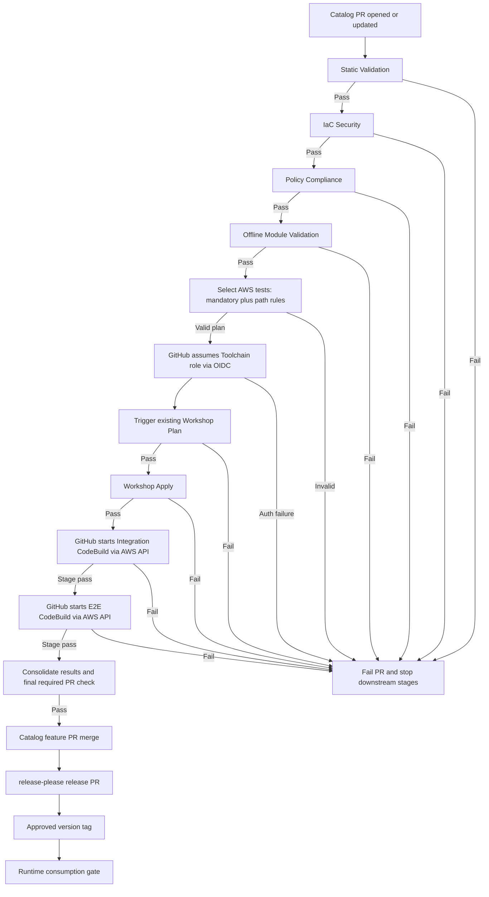

# Terragrunt Toolchain Automated Testing - High-Level Design

**Version:** 3.0 (revised from v2)  
**Status:** Draft for architecture review  
**Scope:** Phase 1 Catalog PR validation, AWS Test execution and future evolution  
**Architecture decisions:** GitHub Actions orchestrates; direct AWS CodeBuild execution; no new CodePipeline; Phase 1 mandatory plus path-rule-selected AWS tests; hybrid Test environment  
**Pending:** Candidate revision delivery details, Workshop invocation integration, test artifact transport finalization, isolation controls, Runtime release enforcement and approvals

> **Change from v2:** Phase 1 AWS tests are no longer a fixed-only suite. The new design combines mandatory tests with centrally defined path-to-test rules. AWS execution is initiated directly by GitHub Actions through the Toolchain account, not through a new CodePipeline. Workshop's existing Plan/Apply process remains unchanged.

# 3. Solution

The **Catalog repository** is the entry point and owner of automated validation for Terragrunt toolchain changes. A pull request to Catalog `main`, including updates to that PR, starts a **sequential, fail-fast GitHub Actions workflow**. GitHub Actions is the **single end-to-end orchestrator** and the authority for required PR status.

AWS-independent checks run first, in ordered stages. Within a stage, all independent checks complete and their results are collected. A failed stage blocks all subsequent stages and fails the PR. Only after every dry-check stage passes does GitHub select AWS tests, initiate Workshop deployment through its **existing mechanism**, and directly invoke AWS CodeBuild through AWS APIs.

AWS tests are authored and maintained by the team in Catalog. Phase 1 selects a **mandatory baseline** plus tests associated with changed paths through **simple centralized rules**. Phase 2 may evolve to dependency-aware Test Impact Analysis (TIA). GitHub produces a deterministic per-PR test plan and receives per-test results; AWS holds the detailed execution diagnostics.

## 3.1. Testing Strategy and Layers

| Ordered stage | Purpose | Execution owner / location | Selection | Failure boundary |
|---|---|---|---|---|
| **1. Static Validation** | Syntax, format, structure and offline Terragrunt/Terraform validation | Catalog GitHub Actions, AWS-independent | Changed validation units with full required context | Complete checks in stage; stop if failed |
| **2. IaC Security** | Detect infrastructure security misconfiguration | Catalog GitHub Actions, AWS-independent | Changed validation units | Complete checks in stage; stop if failed |
| **3. Policy Compliance** | Enforce agreed organization and toolchain policies | Catalog GitHub Actions, AWS-independent | Changed validation units | Complete checks in stage; stop if failed |
| **4. Native / Module Validation** | Offline module assertions and contract tests where applicable | Catalog GitHub Actions, AWS-independent | Affected testable modules | Complete checks in stage; stop if failed |
| **5. AWS Test Selection** | Resolve mandatory tests and path-based rules; validate execution plan | Catalog GitHub Actions | PR diff + central rules + test registry | Invalid or unsafe plan fails closed |
| **6. Workshop Plan** | Verify candidate toolchain against representative Test stacks | Existing Workshop deployment mechanism via Test Toolchain | Approved pilot stacks | Stop if failed |
| **7. Workshop Apply** | Deploy required test infrastructure | Existing Workshop deployment mechanism via Test Toolchain | Approved pilot stacks | Stop if failed |
| **8. AWS Integration** | Validate deployed infrastructure behavior and interactions | CodeBuild in Test Toolchain account | Mandatory + rule-selected integration tests | Complete independent selected tests; stop if stage failed |
| **9. Limited Stack E2E** | Validate representative cross-component paths | CodeBuild in Test Toolchain account | Mandatory + rule-selected E2E tests | Complete independent selected tests; stop if stage failed |
| **10. Final Quality Gate** | Consolidate evidence and report required status | Catalog GitHub Actions | All required stages | PR passes only if all required stages passed |

The exact dry-check ordering and tool assignment should be confirmed against the existing Catalog validation workflow before implementation; the architectural requirement is **explicit sequential stages**, not a single parallel job that masks failure. Terraform native tests in Phase 1 must remain AWS-independent (for example, mock-based) or be classified as AWS tests.

## 3.1.1. Test Coverage and Selection

Phase 1 covers candidate toolchain compatibility and representative AWS infrastructure behavior, without claiming exhaustive production-stack compatibility.

| Coverage area | Phase 1 execution | Phase 2 evolution |
|---|---|---|
| Dry checks | Change-scoped validation of affected units, stage by stage | Improved change impact mapping as justified |
| Workshop Plan / Apply | Existing representative deployment flow after successful dry checks | Expanded fixtures and lifecycle scenarios |
| AWS Integration | Mandatory tests plus path-rule-selected tests | Dependency-aware TIA / risk-based selection |
| Limited Stack E2E | Mandatory tests plus path-rule-selected tests | Dependency-aware TIA / broader coverage |
| Deployment lifecycle assertions | Out of scope: explicit upgrade, idempotency and destroy test scenarios | Consider adding lifecycle testing |
| Cleanup / reset | Operational requirement in both phases | Further automation and optimization |

The team owns individual test implementations. **Centralized rules** define *which tests run for which changed paths*; test source code does not need to implement its own triggering logic.

### Phase 1 rule-based selection

Catalog stores one version-controlled selection policy containing (a) **mandatory test IDs** and (b) **changed-path patterns mapped to test IDs**. For each PR, GitHub Actions evaluates the full changed-file list, unions tests from all matching rules with mandatory tests, deduplicates them and resolves their execution stage. A change under `iam/**`, for example, may select IAM-related integration tests in addition to the mandatory baseline. If multiple paths change, all applicable rules contribute tests.

The rule definitions, test IDs and runnable test inventory must be validated as part of the dry-check workflow. **Changed tests and selection rules must themselves receive appropriate validation.** Unmapped changes that may affect AWS behavior trigger a conservative broad-suite fallback or a failed selection gate; they must never silently produce an insufficient plan. Shared/global changes require explicitly broad rules. The precise path patterns, test IDs and fallback scope belong to the test configuration, not this HLD.

The output is an **immutable per-PR Test Manifest** containing selected test IDs, execution stages, reasons for selection, target environment(s), and candidate revision identity. It is the authoritative execution plan for AWS tests.

## 3.2. High-Level Architecture

| Component | Responsibility |
|---|---|
| **Catalog repository** | Owns toolchain source, test code, mandatory baseline, path-based selection rules, validation configuration and release process |
| **GitHub Actions** | Single orchestrator: stage ordering, dry checks, selection, Workshop invocation, AWS API calls, waiting, status propagation and required PR checks |
| **Test Selector** | Lightweight Catalog-owned logic in GitHub Actions; maps PR changes to test IDs and produces a deterministic Test Manifest; no separate selection service in Phase 1 |
| **Terragrunt Deployment Workshop** | Retains the existing deployment workflow and performs Plan and Apply against approved Test stacks; receives the exact candidate toolchain revision |
| **AWS Test Toolchain account** | Central execution entry point, CodeBuild test project(s), artifacts, reports and controlled cross-account access |
| **AWS Test Dev / Staging / Prod accounts** | Isolated deployment targets in the Test organization; **Test Prod is not real production** |
| **AWS CodeBuild** | Executes selected Catalog-owned AWS tests from the immutable candidate bundle, emits structured test results and detailed logs |
| **Terragrunt Deployment Runtime** | Consumes released toolchain versions for real production; independent release-consumption enforcement remains a design item |

**CodePipeline decision:** Do not introduce a new CodePipeline for Catalog validation or AWS test orchestration. GitHub Actions directly invokes CodeBuild and waits for each build's terminal status. Workshop's existing deployment mechanism remains as-is, including any infrastructure services it already uses. This HLD does not redesign Workshop.

**CodeBuild topology:** Start with a central CodeBuild execution capability in the Test Toolchain account, with logically separate Integration and E2E stages. Reuse one project if its trust, runtime and IAM boundaries permit; split projects if materially different permissions or isolation are required. Do not assume one privileged role can faithfully validate all security boundaries.

## 3.3. CI/CD Testing and Release Flow

The GitHub workflow must capture and wait on the **specific** Workshop run and CodeBuild build IDs that it initiated. API request acceptance is not a passing test result. Timeouts, cancellation, missing evidence, unexpected status and unsuccessful cleanup must be explicitly surfaced. Diagnostic collection and controlled cleanup run even on failure, without allowing cleanup to overwrite the original failure reason.

GitHub Actions controls progression between stages. **Within a stage**, independently runnable tests complete and results are collected before the stage is declared passed or failed. Integration must pass before E2E begins.

The exact means of passing an untagged candidate Catalog revision into Workshop is intentionally deferred. The invariant is that the revision deployed, the test bundle executed and the revision approved are traceably the same candidate.

## 3.4. AWS Test Environment

The dedicated AWS Test organization has **four accounts**:

| Account | Role |
|---|---|
| **Toolchain** | Central test orchestration and execution, CodeBuild, controlled artifact and diagnostic access |
| **Dev** | AWS Test deployment target |
| **Staging** | AWS Test deployment target |
| **Prod** | AWS Test deployment target; distinct from actual production |

**Hybrid lifecycle (confirmed):** Reusable shared Test foundations remain persistent, while PR-specific or collision-prone test resources are provisioned and cleaned up as needed. Exact resource classification, naming, isolation and cleanup/reset ownership are defined during detailed design and pilot readiness.

Concurrency must be controlled so two PRs cannot inadvertently overwrite the same deployed fixtures or produce cross-contaminated results. Approved options include per-PR resource namespaces, isolated ephemeral fixtures, and serialization of shared-resource operations. The chosen controls must be observable and enforceable.

All AWS test execution is initiated through the **Test Toolchain account**. CodeBuild uses narrowly scoped, auditable cross-account roles to reach Dev, Staging and Prod. Tests that verify denial or trust boundaries must use principals that accurately represent the behavior under test; privileged test-runner access must not invalidate security assertions.

## 3.5. Test Execution Contract and Artifact Delivery

The interface between Catalog/GitHub and AWS is a **versioned logical Test Execution Contract**, not a requirement to build a new API service.

| Input | Purpose |
|---|---|
| **Candidate revision** | Exact immutable Catalog commit SHA associated with the PR |
| **Correlation identity** | PR number, GitHub run/attempt, logical execution ID |
| **Test Manifest** | Selected test IDs, stage grouping, target environments and selection reasons |
| **Test bundle reference** | Immutable location and integrity identity of runnable Catalog-owned test code |
| **Environment context** | Approved Workshop deployment outputs or resource references, without embedded credentials |
| **Execution controls** | Stage identity, timeout, allowed target accounts and cleanup/isolation context |

**Artifact flow (proposed implementation pattern):** After selection, GitHub packages the exact Catalog test revision, its runtime dependencies/metadata and the Test Manifest as an immutable **Test Bundle**, then publishes it to a controlled, versioned artifact location accessible to the Toolchain account (recommended: S3). GitHub calls `codebuild:StartBuild` with a reference to that specific bundle and stage. CodeBuild retrieves the bundle, verifies the expected revision/integrity, resolves the selected test IDs from the manifest and executes only that stage's selected tests. The AWS runner/buildspec and IAM role are centrally controlled; an unreviewed PR must not be able to replace the privileged runner configuration.

The artifact-transfer design must account for GitHub-to-S3 permissions, integrity checks, retention and the fact that PR code is untrusted. The exact S3 layout, buildspec and test invocation commands are **LLD**, not HLD commitments. An equivalent immutable source-delivery mechanism may be used if it preserves the same contract.

| Output | Purpose |
|---|---|
| **Overall stage status** | Passed, failed, cancelled, timed out or execution error |
| **Per-test results** | Test ID, outcome, duration and concise failure details |
| **Selection evidence** | What was selected, why, and what was not run |
| **Execution metadata** | CodeBuild build ID, revision, account and correlation identifiers |
| **Diagnostic references** | CodeBuild report, CloudWatch logs and retained artifacts |

GitHub polls the **exact CodeBuild build ID** via AWS APIs until terminal status, collects results, and publishes a GitHub Job Summary plus required check. Missing or unreadable required results are treated as failures, not passes. A separate CodeBuild invocation per logical AWS stage preserves the Integration-to-E2E gate.

## 3.6. Quality Gates, Reporting and Debugging

**GitHub is the primary PR-facing view.** It displays stage status, mandatory/rule-selected tests, selection reasons, per-test outcomes, failed-test summaries, and links to AWS diagnostics. The final required check passes only when every required stage and its evidence are complete and successful.

**AWS is the deep-debugging system.** CodeBuild Test Reports ingest structured test results (for example JUnit XML); CloudWatch Logs retain detailed execution output; build and artifact references support individual-test investigation. The team must be able to identify which test failed in which account and navigate from the GitHub summary to the exact AWS execution.

Minimum observability: GitHub PR and run identifiers, candidate SHA, selected test ID, selection reason, CodeBuild build ID, target account, stage, test result and diagnostic link. Structured diagnostics must exclude secrets and credentials. Define retention for reports and artifacts; longer-term evidence can be retained in controlled S3 storage.

A failed dry-check stage must **not** invoke AWS. A failed Workshop Plan/Apply must **not** run AWS tests. A failed Integration stage must **not** start E2E. Independent tests already started within a stage should finish and report their results where safe.

## 3.7. Phase 1 vs Phase 2 and Design Boundaries

| Capability | Phase 1 | Phase 2 |
|---|---|---|
| Dry checks | Sequential change-scoped stages | Enhanced impact awareness |
| AWS test selection | Mandatory tests + centralized path-to-test rules | Dependency-aware TIA and risk-based selection |
| Test execution | Catalog-owned test bundle executed by Toolchain CodeBuild | Optimize based on observed runtime, cost and coverage |
| Integration | Selected mandatory and path-matched tests | Broader/deeper coverage |
| E2E | Selected limited-stack tests | Expanded golden paths |
| Reporting | GitHub summary + CodeBuild reports + CloudWatch | Trend analytics if justified |
| Test environment | Hybrid lifecycle | Refine isolation and efficiency |
| Lifecycle test scenarios | Explicit update/idempotency/destroy assertions excluded | Evaluate introduction |

The HLD defines ownership, ordering, selection contract, trust boundaries, release gates and evidence. Individual assertions, exact rules, buildspec, IAM policies and deployment scripts remain LLD.

# 4. Alternatives Considered

| Alternative | Assessment | Decision |
|---|---|---|
| Run AWS tests directly on GitHub runners | Does not match organization restriction; also weakens AWS-native diagnostics | Rejected |
| CodeBuild-hosted GitHub Actions runners | Not available under current organization policy | Rejected |
| New CodePipeline for Catalog test orchestration | Adds a second orchestration layer when GitHub already owns the end-to-end gate | **Not selected** |
| Direct GitHub Actions → CodeBuild AWS API | Clear stage control, OIDC authentication, exact build tracking and native AWS reporting | **Selected** |
| Fixed-only AWS suite | Simple but runs unnecessary tests and ignores requested change-based behavior | Replaced |
| Central path rules + mandatory baseline | Straightforward, auditable and maintainable in Phase 1 | **Selected** |
| Test-local trigger logic in every test | Makes selection harder to review centrally and validate consistently | Not selected for Phase 1 |
| Dependency-aware TIA in Phase 1 | Adds mapping/graph complexity before pilot data exists | Deferred to Phase 2 |
| Persistent-only or ephemeral-only test environment | Either risks collisions or increases setup cost/time | Hybrid selected |

# 5. Security, Cost, and Operations

## 5.1. Security / IAM

- GitHub Actions uses **OIDC** to assume an approved, narrowly scoped IAM role in the Test Toolchain account. The trust policy must restrict the permitted GitHub repository/workflow context; do not grant arbitrary PR code direct access to privileged credentials.
- The GitHub role is limited to the required artifact upload, CodeBuild start/status/report retrieval and approved Workshop invocation operations.
- AWS CodeBuild runs centrally in Toolchain with a dedicated execution role; access to target accounts is through scoped, auditable `sts:AssumeRole` permissions.
- PR-supplied test code is untrusted. Apply least privilege, avoid broad write access, prevent unauthorized changes to runner configuration, and separate privileged setup operations from test code.
- The hybrid environment needs isolation controls, resource naming and cleanup, including concurrency protection.
- The Test Prod account is distinct from real production; no test execution may target real production by accidental configuration.
- The test artifact must be pinned to a revision and integrity identity; sensitive values are never embedded in the manifest or logs.

## 5.2. Cost (USD)

Costs remain **TBD** pending measured pilot data. Main drivers are CodeBuild runtime, Workshop Plan/Apply duration, test resource lifetime, data transfer, S3 artifacts and CloudWatch retention. The hybrid model aims to reuse shared foundations while limiting temporary resources.

Pilot measurement should record total duration, AWS execution duration, test count selected, test count run, average runtime by stage, artifact/log volume and approximate per-PR cost. No unverified savings or cost estimates are assumed.

## 5.3. Operations and Observability

- Catalog owns workflow reliability, selection rules and required GitHub checks.
- Workshop owners retain deployment operations and infrastructure reset responsibilities under the agreed boundary.
- Test authors own test definitions and maintenance, including mapping tests into centralized selection rules.
- CodeBuild report and CloudWatch access must be available to authorized engineers; GitHub summaries should link to exact builds.
- Failed runs require a recoverable environment and retained diagnostics; cleanup errors are separately visible.
- Stage and test timeout policies, retries, cancellation behavior, resource isolation and report retention are pilot deliverables.
- Prefer rerunning the same immutable candidate/test manifest for reproducibility; any retry should have its own attempt identity.

## 5.4. Dependencies

| Dependency | Owner / prerequisite |
|---|---|
| Four AWS Test accounts and cross-account access | Thunder / Platform / Security |
| Existing Workshop candidate Plan/Apply integration | Workshop owners |
| GitHub OIDC role and least-privilege AWS API access | Platform / Security |
| CodeBuild central execution capability | Platform / Toolchain |
| Immutable artifact location and retention | Platform / Security |
| Catalog test inventory and central selection rules | Toolchain test owners |
| Hybrid isolation, cleanup and concurrent-run controls | Platform / Workshop |
| Release version provenance and Runtime consumption controls | Catalog / Runtime owners |

# 6. Risks and Pre-Mortem

| Risk / failure mode | Impact | Mitigation / pilot proof |
|---|---|---|
| Rule misses a changed component | Required AWS test not selected | Validate mapping coverage; conservative fallback; review selection reasons |
| Shared/global change incorrectly mapped narrowly | Cross-component regression escapes | Broad rules for shared paths; mandatory baseline |
| Candidate revision differs across checks, Workshop and CodeBuild | Invalid approval evidence | Immutable SHA and bundle integrity, correlated deployment identity |
| Privileged CodeBuild runner masks security failures | False positive | Representative test principals and explicit trust-boundary review |
| PR code gains unintended AWS privileges | Security incident | Scoped OIDC and CodeBuild roles, controlled runner, artifact verification |
| Two PRs collide in shared Test resources | Flaky or misleading results | Hybrid isolation / serialization; per-run correlation |
| AWS failure not propagated to GitHub | Unsafe merge | Poll exact build/run IDs; fail closed on timeout/missing evidence |
| Report is too generic to debug | Slow recovery | Per-test JUnit, CloudWatch, stage/test/account correlation and links |
| Cleanup fails after partial deployment | Stale or costly resources | Cleanup on failure, ownership, alerts, reset/rollback procedures |
| Test selection and runtime become expensive | Slow PR feedback | Pilot metrics; Phase 2 optimization based on evidence |
| Release tag does not match validated revision | Unvalidated Runtime consumption | Release provenance validation and enforceable Runtime gate |

# 7. Rollout Sketch

## 7.1. Pilot Scope

Pilot with **one internal Workshop project** using the four-account AWS Test topology. Preserve Workshop's current Plan/Apply mechanism. Implement Catalog GitHub orchestration, stage-by-stage dry checks, rule selection, Toolchain CodeBuild integration and GitHub/AWS reporting before broadening adoption.

## 7.2. Pre-Pilot Readiness and Abort Criteria

Do not start the pilot unless: Test account access and boundaries are confirmed; OIDC permissions are reviewed; the existing Workshop workflow can accept an identifiable candidate revision; the mandatory and path-rule mapping is reviewable; the test bundle can be delivered immutably; a CodeBuild build can be triggered and tracked by ID; and shared/temporary resources have a safe isolation and reset approach.

Abort or defer if a PR can run AWS without passing dry checks, if a failed AWS stage can be reported as success, if candidate identity is not traceable, or if test code has uncontrolled privileged access.

## 7.3. During-Pilot Abort Criteria

Pause rollout if: AWS tests run on a mismatched revision; a rule change silently drops required tests; parallel PRs corrupt shared fixtures; CodeBuild results are missing from GitHub; a failed stage triggers a downstream stage; cleanup repeatedly fails; or AWS cost/runtime exceeds agreed operational limits. Resume only after remediation and owner review.

## 7.4. Rollout Waves

| Wave | Scope | Exit condition |
|---|---|---|
| **0. Readiness** | Accounts, OIDC, Workshop candidate identity, artifact path, CodeBuild roles, hybrid isolation | Security and pre-pilot gates approved |
| **1. Internal Pilot** | Sequential Catalog workflow, mandatory + rule-selected tests, direct CodeBuild, reporting | End-to-end success and failure cases demonstrated |
| **2. Catalog Enforcement** | Required checks, rule ownership, release provenance, operational response | No bypass of required tests; reproducible diagnostics |
| **3. Broader Adoption** | More paths, test scenarios and projects | Coverage, reliability and cost reviewed |
| **Future Phase 2** | Dependency-aware TIA and optional advanced test lifecycle | Approved after pilot evidence |

Rollback of mandatory checks requires an approved, time-bounded exception with compensating release controls. Do not silently permit unvalidated toolchain tags to reach Runtime.

# 8. Open Questions, Decisions, ADRs, and Approvals

## 8.1. Open Questions

| ID | Question | Status |
|---|---|---|
| OQ-01 | How exactly will the existing Workshop workflow receive the untagged Catalog candidate revision? | Open, HLD invariant established |
| OQ-02 | What is the precise immutable bundle transport and integrity mechanism? | Proposed S3; LLD to finalize |
| OQ-03 | Which Test resources persist, which are temporary, and how are concurrent PRs isolated? | Hybrid selected; details open |
| OQ-04 | What are the specific mandatory tests, path mappings and broad fallback rules? | To define in Catalog test configuration |
| OQ-05 | Which CodeBuild runtime and project split best satisfy trust boundaries? | One central capability selected; project split open |
| OQ-06 | Who owns reset/cleanup for partial Workshop failures and abandoned runs? | Open |
| OQ-07 | What are the pilot thresholds for duration, cost, report retention and reliability? | Open |
| OQ-08 | How will release-please tag provenance and Runtime consumption enforcement work? | Open |
| OQ-09 | Which internal Workshop project and test fixtures will be used for pilot? | Open |
| OQ-10 | Which exact dry-check stages and tools are already present and what is their approved order? | Verify existing workflow |

## 8.2. Decisions

| ID | Decision | Status |
|---|---|---|
| D-01 | Catalog PR creation/updates trigger the workflow; GitHub Actions is the sole validation orchestrator. | Confirmed |
| D-02 | Stages run sequentially and fail-fast; independent tests within a stage complete before stage verdict. | Confirmed |
| D-03 | AWS-independent dry checks run before any AWS execution. | Confirmed |
| D-04 | Phase 1 AWS tests = mandatory baseline + centralized path-rule-selected tests. | Confirmed |
| D-05 | Phase 2 introduces dependency-aware TIA; not required for Phase 1. | Confirmed |
| D-06 | No new CodePipeline for Catalog; direct AWS CodeBuild invocation through AWS API. | Confirmed |
| D-07 | GitHub assumes an approved Toolchain IAM role through OIDC. | Confirmed |
| D-08 | Existing Workshop Plan/Apply mechanism is preserved. | Confirmed |
| D-09 | Catalog owns tests and selection; CodeBuild executes them centrally in Test Toolchain. | Confirmed in principle |
| D-10 | AWS Test organization has Toolchain, Dev, Staging and Prod accounts; Test Prod is not real production. | Confirmed |
| D-11 | Test resource lifecycle is hybrid. | Confirmed |
| D-12 | Candidate revision must be identical/traceable through deployment, testing and release; mechanism deferred. | Confirmed principle |
| D-13 | GitHub required checks summarize results; CodeBuild reports and CloudWatch provide deep diagnostics. | Confirmed |
| D-14 | Integration and E2E are separate logical gated stages; no E2E after Integration failure. | Confirmed |
| D-15 | Deployment lifecycle test scenarios excluded from Phase 1; operational cleanup remains required. | Confirmed |
| D-16 | release-please release PR and version tag follow validated Catalog merge; Runtime enforcement design remains open. | Confirmed principle |

## 8.3. Proposed ADRs

| ADR | Subject | Status |
|---|---|---|
| ADR-001 | GitHub Actions orchestration, direct CodeBuild execution and no new CodePipeline | Proposed |
| ADR-002 | Sequential fail-fast stages and per-stage result collection | Proposed |
| ADR-003 | Mandatory + centralized path-rule-based selection in Phase 1 | Proposed |
| ADR-004 | Immutable Test Execution Contract and Catalog-to-CodeBuild artifact delivery | Proposed |
| ADR-005 | Four-account Test topology, OIDC, CodeBuild trust and cross-account IAM | Proposed |
| ADR-006 | Hybrid Test lifecycle and PR isolation | Proposed |
| ADR-007 | GitHub quality gate with AWS-native detailed reporting | Proposed |
| ADR-008 | Candidate revision and release provenance / Runtime enforcement | Proposed |

## 8.4. Approvals

| Area | Approver | Status |
|---|---|---|
| Catalog orchestration and rule-selection design | Catalog / Platform owner | Pending |
| Workshop integration and hybrid lifecycle | Workshop / Platform owner | Pending |
| IAM and PR-code trust boundaries | Security | Pending |
| Test coverage and ownership | Toolchain test lead | Pending |
| Release provenance and Runtime gate | Release / Runtime owner | Pending |
| Pilot cost, readiness and rollout | Platform / Operations | Pending |

## References

- [GitHub Actions workflow syntax and job dependencies](https://docs.github.com/en/actions/reference/workflows-and-actions/workflow-syntax)
- [GitHub Actions OIDC for AWS](https://docs.github.com/en/actions/how-tos/secure-your-work/security-harden-deployments/oidc-in-aws)
- [AWS CodeBuild StartBuild API](https://docs.aws.amazon.com/codebuild/latest/APIReference/API_StartBuild.html)
- [AWS CodeBuild BatchGetBuilds API](https://docs.aws.amazon.com/codebuild/latest/APIReference/API_BatchGetBuilds.html)
- [AWS CodeBuild test reporting](https://docs.aws.amazon.com/codebuild/latest/userguide/test-reporting.html)
- [AWS STS AssumeRole API](https://docs.aws.amazon.com/STS/latest/APIReference/API_AssumeRole.html)
- [GitHub REST API: List pull request files](https://docs.github.com/en/rest/pulls/pulls#list-pull-requests-files)
