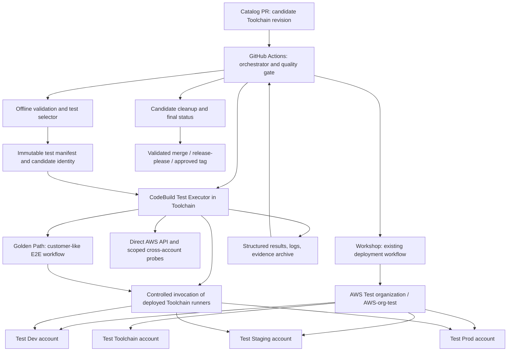
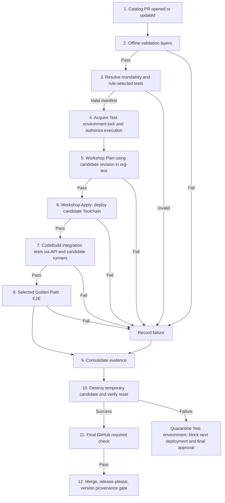

# Terragrunt Toolchain Automated Testing - High-Level Design

**Version:** 4.0  
**Status:** Proposed for architecture review  
**Scope:** Phase 1 candidate validation, AWS Test execution, evidence, and controlled release; Phase 2 direction  
**Baseline:** Terragrunt Toolchain Automated Testing HLD v3  
**Primary design objective:** Establish a reusable testing mechanism that can execute future team-authored tests against a newly proposed Toolchain revision, without redesigning the CI/CD architecture for each test.

## 1. Overview

The solution validates a proposed **Catalog Toolchain revision before it is released for consumption**. A Catalog pull request (PR) triggers layered checks, deploys that exact candidate revision through Workshop into a dedicated four-account AWS Test organization, runs selected tests against the deployed Toolchain, retains evidence, cleans up candidate resources, and returns an authoritative GitHub quality-gate result.

The system validates both the infrastructure definition and the behavior of the Toolchain **as a consumer would use it**. It must therefore support tests executed centrally through AWS APIs and tests executed **through the actual Toolchain runners** deployed in the Test accounts. A test author's choice of execution context must not require a new orchestration architecture.

This HLD defines architectural responsibilities, stage boundaries, test selection, execution modes, candidate provenance, security boundaries, lifecycle, evidence, and release controls. It deliberately does not prescribe individual test assertions, buildspec commands, IAM policy JSON, file layouts, or Terraform/Terragrunt implementation details.

### 1.1. Design principles

1. **Test the candidate, not the last release.** The deployed revision must be the same proposed Toolchain revision being approved.
2. **Keep one orchestrator.** GitHub Actions controls the full PR validation state; Workshop owns deployment and AWS CodeBuild executes AWS tests.
3. **Layer tests by purpose, select by policy.** Testing layers explain coverage; mandatory and change-based rules determine which tests run.
4. **Use real identities for behavioral assertions.** A Dev runner's permissions cannot be validated by a privileged Toolchain executor impersonating a different principal.
5. **Prefer a small reusable execution platform.** New tests extend the Catalog-owned registry and test implementations rather than creating a pipeline or CodeBuild project for each test.
6. **Fail closed and preserve evidence.** Missing results, identity mismatch, failed cleanup, and unverified releases cannot be reported as successful validation.
7. **Separate architecture from implementation.** The HLD specifies contracts and invariants; the LLD specifies commands, policies, and resource definitions.

## 2. Scope and Requirements

### 2.1. In scope: Phase 1

- Validation of Catalog PRs targeting `main`, including PR updates, before merge.
- Sequential, fail-fast validation layers with appropriate result aggregation inside each layer.
- Mandatory baseline tests and rule-selected tests based on Catalog changes.
- Candidate Plan and Apply using the existing Workshop deployment mechanism and the `AWS/org-test` hierarchy.
- A dedicated AWS Test organization with Toolchain, Dev, Staging, and Prod accounts.
- A generic AWS execution mechanism for API-based, cross-account, Toolchain-runner-based, and limited customer-like E2E tests.
- Hybrid environment lifecycle: persistent foundation and temporary candidate Toolchain resources.
- Structured evidence, actionable debugging, cleanup, and enforced Catalog release gates.
- One active AWS candidate validation at a time against the shared Test environment.

### 2.2. Out of scope: Phase 1

- Comprehensive production-workload compatibility certification.
- Dedicated upgrade, idempotency, and destroy **test scenarios**. Operational teardown is nevertheless mandatory.
- Dependency-graph-based Test Impact Analysis (TIA), dynamic risk scoring, and a separate test-selection service.
- Replacing Workshop's established deployment engine or Runtime's deployment architecture.
- Building a new general-purpose workflow platform, scheduler, or test portal.
- Detailed test inventory, test fixtures, code, IAM statements, buildspecs, and exact cleanup commands.

### 2.3. Success criteria

The mechanism is successful when an engineer can add a test in Catalog, declare its selection conditions and execution context, and have it executed with reproducible evidence during the appropriate Catalog PR runs. A failed mandatory check, AWS test, candidate deployment, or required cleanup must prevent the PR from being marked fully validated. The released revision must be traceable to the approved validation evidence.

## 3. Solution

### 3.1. Testing Strategy and Layers

Testing layers define **what is being validated** and the logical order. They are distinct from test selection and execution technology. The team may author tests using suitable frameworks, provided they satisfy the common test contract described in Section 3.5.

| Ordered layer | Validation objective | Execution boundary | Selection approach | Gate |
|---|---|---|---|---|
| **1. Static Validation** | Syntax, formatting, Terragrunt/Terraform structure, offline configuration consistency | GitHub, no AWS access | Changed validation units with full dependency context | Required |
| **2. IaC Security** | Infrastructure configuration risks and unsafe defaults | GitHub, no AWS access | Affected units | Required |
| **3. Policy Compliance** | Agreed Toolchain/IaC policies and guardrails | GitHub, no AWS access | Affected units | Required |
| **4. Native / Module Validation** | Offline module contracts and assertions where supported | GitHub, no AWS access | Affected modules | Required where applicable |
| **5. Test Selection** | Produce a complete, valid plan of AWS tests | GitHub | Mandatory baseline plus change-based rules | Required |
| **6. Candidate Plan** | Candidate produces a valid plan against representative Test stacks | Existing Workshop flow, Test organization | Defined Test deployment scope | Required |
| **7. Candidate Apply** | Candidate can provision the required Toolchain and fixtures | Existing Workshop flow, Test organization | Defined Test deployment scope | Required |
| **8. AWS Integration** | Deployed resources, IAM, APIs, and cross-account behavior operate correctly | Test Executor and/or candidate runners | Mandatory plus rule-selected | Required |
| **9. Limited E2E** | A customer-like workflow operates through the deployed Toolchain | Golden Path repository using Test Toolchain | Mandatory plus rule-selected | Required |
| **10. Evidence, Cleanup, Final Gate** | Results are complete, candidate is removed, approval is trustworthy | GitHub and AWS | All required stages | Required |

**Stage semantics.** A failed dry-check layer prevents AWS deployment. A failed Plan prevents Apply; a failed Apply prevents behavioral tests; a failed Integration stage prevents E2E. Independent tests already running within a stage should complete and report where safe. Evidence collection and cleanup are unconditional recovery obligations, not downstream validation tests that can be skipped after failure.

The exact offline tools and their order must be aligned with the existing Catalog workflow during implementation. AWS-independent tests must not silently use live providers, remote AWS state, or credentials; tests requiring AWS belong in the AWS execution stages.

#### 3.1.1. Coverage boundaries

The Phase 1 baseline should provide confidence in five broad areas, rather than enumerate every possible test:

| Coverage dimension | Intended confidence |
|---|---|
| **Configuration correctness** | Proposed Toolchain code is structurally valid and meets defined offline contracts |
| **Security and policy** | IaC guardrails pass, and deployed identity/network boundaries behave as intended |
| **Deployment viability** | The proposed revision can Plan and Apply against representative Test account stacks |
| **Runtime integration** | Created Toolchain components and cross-account interactions operate as expected |
| **Consumer workflow** | A representative customer-like project can use the deployed Toolchain end to end |

This is a **representative release gate**, not an assertion that every possible client configuration is tested.

### 3.2. Test Selection and Extensibility

Phase 1 combines two independent selection mechanisms:

- **Mandatory baseline:** designated tests run for every candidate regardless of changed files.
- **Rule-selected coverage:** additional tests run when a Catalog change matches their declared applicability conditions.

Test authors define **when** a test should run as part of registering the test. Catalog remains the version-controlled source of truth for test implementations, test metadata, mandatory status, selection rules, execution context, stage, and expected result contract. A lightweight Catalog-owned selector interprets this information; there is **no separate selector service** in Phase 1.

#### 3.2.1. Selection sequence

1. GitHub identifies the candidate revision and the full PR changed-file set.
2. The selector loads the approved test registry and selection policy **from the candidate revision**, subject to independent policy validation.
3. It includes all mandatory tests and unions tests matched by change rules.
4. It validates test IDs, stage assignments, supported execution contexts, required account targets, and dependencies; duplicate selections are removed.
5. Changes to tests, registry, selection rules, or shared infrastructure are explicitly covered. Unknown or ambiguous impact produces a conservative broader suite or a failed selection gate, never an empty success by default.
6. It creates an immutable **Test Manifest** recording selected tests, reasons, execution contexts, target accounts, stages, and candidate identity.
7. GitHub retains the manifest and passes the relevant stage subset to the AWS Test Executor after deployment.

**Example:** A change to Toolchain IAM code selects the mandatory baseline and IAM-relevant integration tests. One selected test may run as an AWS API probe; another may request execution by the deployed Dev runner to verify an expected access denial. Both follow the same selection and result contract.

#### 3.2.2. Future-test onboarding contract

A new test must declare, at the architectural level:

| Attribute | Meaning |
|---|---|
| **Stable test ID and owner** | Identifies the test for selection, reporting, maintenance, and history |
| **Testing layer / stage** | Determines when it can run and what must succeed first |
| **Trigger conditions** | Mandatory status and/or changed-path/component rules |
| **Execution mode** | Central API executor, target-account identity, candidate runner, or customer-like E2E workflow |
| **Target and prerequisites** | Test account(s), required deployed capability, and any fixture dependencies |
| **Execution and result contract** | Callable test entry point, timeout, structured status, diagnostics, and cleanup obligations |

The contract is intentionally framework-neutral. Tests may be implemented with Terratest, SDK clients, Terraform-native tests where appropriate, or other approved frameworks. The selection policy is centralized and reviewable even when metadata is maintained adjacent to test source.

**Why this design:** A mandatory-only suite becomes slow as coverage grows; a change-only suite can miss systemic regressions; dependency-aware TIA requires an accurate graph and maintenance burden before there is enough empirical data. Mandatory plus explicit rules provides transparent, reviewable Phase 1 behavior and a straightforward migration path to TIA in Phase 2.

### 3.3. High-Level Architecture

| Component | Responsibility |
|---|---|
| **Catalog** | Candidate Toolchain source, test code, test registry, selection policy, PR validation and release ownership |
| **GitHub Actions** | Sole end-to-end orchestrator: sequencing, selection, invocation, correlation, waiting, evidence consolidation and PR status |
| **Workshop** | Existing Plan/Apply/Destroy deployment capability; test-specific hierarchy under `AWS/org-test` |
| **Test Toolchain account** | Central execution entry point, CodeBuild Test Executor, controlled test artifacts, evidence and approved cross-account access |
| **Test Dev / Staging / Prod** | Representative customer account topology and candidate Toolchain deployment targets; Test Prod is not real production |
| **Test Executor (CodeBuild)** | Generic controlled test runner, reads the manifest, dispatches selected tests in supported execution modes, normalizes results |
| **Candidate Toolchain runners** | Actual deployed runners used when a test must execute with consumer-equivalent identity, network, and permissions |
| **Golden Path repository** | Separate customer-like project/workflow used for selected E2E validation; not a second test orchestrator |
| **Runtime** | Consumes approved released versions; must not bypass the tested-version control |

**Execution topology decision.** Use a small number of reusable CodeBuild execution projects, not one CodeBuild project per test. Separate execution projects or roles **only where trust boundaries or runtime requirements justify separation**. A logical Test Executor can dispatch many tests while keeping the test code and selection rules in Catalog. The exact number of projects is an LLD/pilot decision.

### 3.4. End-to-End Candidate Validation Flow

**Flow clarifications:**

- **Steps 2 and 3 are different.** Step 2 evaluates the candidate's offline correctness. Step 3 determines the **AWS test plan** to execute later. Selection is not execution.
- **Steps 5 and 6 deploy the proposed version.** The candidate is the exact new code revision in the PR, not a previously published Toolchain tag. Workshop performs Plan and Apply with that revision in `AWS/org-test`.
- **Step 7 is the generic test mechanism.** CodeBuild runs or dispatches the selected tests against the actual candidate deployment. It may call AWS APIs or invoke a deployed Toolchain runner, depending on the test contract.
- **Step 8 uses the Golden Path repository as a consumer fixture.** It validates a representative client workflow through the Toolchain; it does not take over orchestration.
- **Steps 9 and 10 must still run on failure.** Failure to complete candidate cleanup leaves the environment unavailable for another candidate until recovery.
- **Step 11 is the authoritative verdict.** A successful AWS API trigger or a green CodeBuild build without complete required test evidence is insufficient.

#### 3.4.1. Candidate revision and Workshop integration

Workshop currently consumes Toolchain versions through configuration such as `catalog_version` in `account.hcl`. For Test deployments, Workshop will support a **controlled candidate override** that points to the proposed Catalog revision. This override is allowed only under `AWS/org-test` and must not alter production deployment behavior under `AWS/org-prod`.

The candidate revision is represented by an immutable commit identity for the PR, but the design intent is straightforward: **Plan, Apply, and subsequent tests all validate the same new Toolchain version**. The workflow records the candidate identity and the effective deployed revision; a mismatch fails validation. The exact override syntax and artifact retrieval belong to the LLD.

For the shared Test environment, AWS candidate deployment is **serialized**. A run holds the environment lock through evidence capture, cleanup, and reset verification. Superseded or cancelled PR runs must not release the lock while leaving an active deployment behind.

### 3.5. AWS Test Execution Mechanism

**Selected approach:** GitHub Actions invokes a controlled **CodeBuild Test Executor** in the Test Toolchain account using an approved AWS API path, preferably short-lived OIDC credentials and restricted `StartBuild` permissions. GitHub waits for the **exact build ID** and evaluates the resulting per-test evidence. If direct invocation is not approved, the existing permitted AWS deployment/invocation integration may be used as an adapter; introducing a new CodePipeline solely for testing is not the default.

CodeBuild is an execution engine, not the owner of the overall workflow. Its controlled buildspec launches the test harness, loads the approved Test Manifest and immutable test bundle, executes the selected stage, and publishes standardized results. The test code may reside in Catalog, while the privileged executor configuration is managed separately from unreviewed PR content.

#### 3.5.1. Two execution modes under one contract

| Mode | How execution works | Appropriate validation |
|---|---|---|
| **Central / API-based** | Test Executor uses an approved identity and narrowly scoped cross-account roles to query or exercise deployed AWS resources | Resource properties, service API behavior, positive cross-account integration, configuration inspection |
| **Candidate-runner-based** | Test Executor requests a controlled job through a deployed Toolchain runner in Dev, Staging, or Prod; the job runs with that runner's actual identity, network and permission boundaries | Denied operations, runner behavior, CodeArtifact access, cross-account artifact isolation, realistic consumer execution |

A third **consumer E2E pattern** uses the Golden Path repository to initiate a representative workflow through the deployed Toolchain, with the Test Executor/GitHub tracking its exact completion and collecting results. It reuses the same reporting contract rather than requiring a separate orchestration platform.

**Representative negative-permission test:** To validate that the Dev runner cannot write to a Prod artifact location, the Test Executor arranges for a bounded test job to execute **on the Dev runner**. The job attempts the write using the runner's actual AWS principal; the expected `AccessDenied` is a **passing test assertion**. A successful write is a failure. The executor itself must not perform the write with a more privileged role, because that would not validate the Dev runner's permissions.

**Execution delivery boundary:** The central executor must use an approved, authenticated invocation channel to reach candidate runners, and collect an unambiguous completion/result signal. Existing Toolchain-supported execution mechanisms should be reused rather than creating a bespoke agent. The exact channel, runner job packaging, and buildspec locations are LLD design items, with feasibility demonstrated during the pilot.

#### 3.5.2. Logical Test Execution Contract

| Input | Required meaning |
|---|---|
| Candidate identity | Exact Catalog revision deployed by Workshop |
| Run identity | PR, GitHub run and attempt, unique validation execution ID |
| Test Manifest | Selected IDs, selection reasons, stages, execution modes, targets and dependencies |
| Immutable test bundle | Versioned and integrity-verifiable Catalog-owned test implementations |
| Deployment context | Approved resource references and outputs from Workshop, without credentials |
| Execution constraints | Allowed accounts, timeouts, required identity, cleanup and result expectations |

| Output | Required meaning |
|---|---|
| Stage and test verdicts | Passed, failed, skipped, cancelled, timed out, or infrastructure error |
| Test evidence | Assertion result, duration, expected/actual outcome and relevant diagnostic context |
| Execution provenance | Candidate revision, test bundle identity, execution identity, AWS account/principal context |
| Diagnostic references | CodeBuild build ID, report references, CloudWatch log links, archived artifacts |
| Cleanup result | Candidate removal and environment readiness verdict |

**Proposed artifact pattern:** Publish a candidate-specific immutable Test Manifest and test bundle to controlled, encrypted S3 storage accessible to the Toolchain executor. This is a transport choice, not a new service. The executor verifies expected revision/integrity before execution. A source-delivery mechanism with equivalent immutability and access controls is acceptable if it fits existing organization tooling better.

**Security requirement:** A PR must not be able to supply arbitrary privileged build commands, alter CodeBuild's trusted buildspec, change its service role, choose unapproved target accounts, or modify the execution policy. Catalog tests are untrusted until validated and must execute with the minimum privileges needed for their specific mode. Trusted setup, dispatch, and result verification must be separated from candidate-controlled code.

### 3.6. AWS Test Environment and Lifecycle

#### 3.6.1. Four-account topology and prerequisites

| Account | Architectural purpose |
|---|---|
| Toolchain | Central Test Executor and orchestration entry point; deploys and exercises the candidate Toolchain |
| Dev | Represents the less-trusted customer development environment and its runner behavior |
| Staging | Represents the trusted staging environment and its runner behavior |
| Prod | Represents the trusted production-like environment **within the Test organization only** |

The Workshop Test hierarchy is maintained under `AWS/org-test`, distinct from `AWS/org-prod`. It can be adapted to the testing use case without modifying the production hierarchy. The baseline must supply the required account provisioning, administrative roles, regional enablement, network connectivity, and shared dependencies for representative deployment. Candidate-specific configuration, runners, and Toolchain stacks are created by Workshop.

The existing Toolchain deployment has prerequisites including LZA-provisioned accounts and admin roles, enabled target regions, spoke VPCs and runner subnets, egress for services such as CodeArtifact, and consumer configuration files. These inform the **readiness boundary**, but this HLD does not replicate a detailed organization setup runbook.

#### 3.6.2. Hybrid lifecycle

**Approved principle:** Persistent foundation plus full teardown of the temporary candidate deployment after each validation attempt.

- **Persistent foundation:** Account/organization setup, shared hub/spoke connectivity and other reusable prerequisites that should not be rebuilt for every PR.
- **Temporary candidate:** The Toolchain deployment and test-specific resources required to validate the new revision, including candidate runners and representative test fixtures as appropriate.
- **Lifecycle owner:** Workshop owns infrastructure operations; GitHub orchestrates invocation and observes completion. The Test Executor may participate in test-level teardown but is not assumed to own the full infrastructure state.

A partial Apply, failed test, timeout, or cancelled run must trigger best-effort teardown, reconciliation, and a verified reset before the next candidate begins. If reset cannot be verified, the shared Test environment is **quarantined** and an owner is alerted. The original test failure and the cleanup failure are both preserved; cleanup failure cannot convert a failing run into success.

The exact permanent/temporary resource inventory, Terraform state boundaries, and whether specific shared Toolchain dependencies must remain persistent are **LLD and pilot decisions**, constrained by security and cost. The principle is fixed; the classification is not.

### 3.7. Quality Gates, Reporting, Evidence and Release

#### 3.7.1. Result propagation and debugging

GitHub is the PR-facing source of truth. It tracks each specific Workshop execution and CodeBuild build ID until terminal state. The final required check includes selected test IDs and reasons, stage/test outcomes, candidate identity, target account and execution mode, failure summaries, and links to AWS diagnostics.

CodeBuild produces structured test reports (preferably JUnit XML or another natively supported format); CloudWatch captures detailed executor logs. Candidate-runner and Golden Path execution must return structured results to the central reporting contract, rather than relying solely on a CodeBuild process exit code. A test reporting an expected access denial must be recorded as **pass**, not treated as an infrastructure execution failure.

**Fail-closed conditions:** An AWS build that starts but never finishes, a missing required report, incomplete test results, a mismatched candidate revision, an untracked runner job, a timeout, an unsafe target account, or a failed required cleanup cannot produce a passing final gate.

#### 3.7.2. Evidence retention policy

**Recommended HLD policy:** Retain an immutable release-validation record and its structured evidence for **at least 12 months**, subject to the organization's formal retention/security policy; retain detailed execution logs for **90 days in CloudWatch** and export/compress required diagnostic bundles to encrypted S3 for the same 12-month validation window. Use S3 lifecycle transitions for older evidence and automatic expiration when the approved period ends. Preserve security-incident or compliance-hold records according to the applicable hold policy.

This is a **proposed retention baseline for approval**, not a claim of an existing organizational requirement. The exact periods and storage classes should be confirmed with Security/Operations and validated against pilot costs. The choice deliberately distinguishes fast operational debugging from durable release provenance. AWS CodeBuild's native test-report console retention is only **30 days**, so durable evidence must be exported independently.

Evidence must include the Test Manifest, candidate and released revision identities, Plan/Apply references, structured per-test results, failure diagnostics, cleanup outcome, and final GitHub verdict. Credentials and secrets must not be archived.

#### 3.7.3. Release integrity

1. Required Catalog checks protect the feature PR merge into `main`.
2. `release-please` creates the release PR and, following approval, the version tag.
3. The release process must establish **provenance between the tested candidate and the release artifact/tag**. If release generation changes deployable Toolchain content, the release candidate requires equivalent validation before publishing or consumption.
4. Runtime must accept only an approved released Toolchain version through an enforceable consumption control, not merely through convention.

The exact provenance attestation, allowed-version enforcement and release PR validation mechanism are LLD/release-control design items. The HLD requirement is non-bypassable traceability between validated content and consumed content.

### 3.8. Phase 1 versus Phase 2

| Capability | Phase 1 | Phase 2 / possible evolution |
|---|---|---|
| Validation layers | Explicit ordered offline, deployment, integration, E2E stages | Extend coverage based on observed failures |
| Selection | Mandatory baseline plus simple change rules | Dependency-aware TIA and risk-based rules if justified |
| Test authoring | Catalog-owned test registry and generic execution contract | Richer dependency metadata and self-service tooling |
| AWS execution | Generic CodeBuild Test Executor with API and candidate-runner modes | Optimize parallelism or isolate runtimes based on evidence |
| Candidate deployment | Workshop Plan/Apply in `AWS/org-test` | Broader representative environments or lifecycle scenarios |
| Environment lifecycle | Persistent foundation, ephemeral candidate, serialized AWS validation | Controlled parallel candidate environments if economically justified |
| Reporting | GitHub quality gate, CodeBuild reports, CloudWatch and S3 evidence | Historical reliability/coverage analytics |
| Deployment lifecycle tests | Dedicated upgrade/idempotency/destroy assertions excluded | Evaluate explicit lifecycle test coverage |

## 4. Alternatives Considered and Decision Rationale

Only architecture-shaping alternatives are recorded here. Exact implementation choices should be documented in the LLD or in future ADRs.

| Decision area | Alternatives evaluated | Preferred approach | Rationale and trade-off |
|---|---|---|---|
| **Orchestration** | GitHub-only, new CodePipeline, mixed control plane | **GitHub as sole orchestration authority** | Keeps one PR gate and avoids duplicated workflow state. Requires reliable AWS execution-status correlation |
| **AWS test execution** | GitHub-hosted runners, CodeBuild-hosted GitHub runners, CodePipeline, direct CodeBuild | **Controlled CodeBuild Test Executor** | Fits current tooling restrictions, supports AWS-native diagnostics and reusable test execution. Direct OIDC StartBuild requires security approval |
| **Test execution topology** | One CodeBuild project per test, one privileged universal runner, small reusable executor pool | **Small reusable executor capability with separated trust boundaries** | Avoids resource sprawl while preserving identity fidelity. Some tests require dispatch to actual candidate runners |
| **Test selection** | Always run all, change-only, mandatory + rules, graph-based TIA | **Mandatory + explicit change rules** | Balances coverage, auditability and cost without a dependency-graph platform |
| **Selection ownership** | Trigger logic inside each test, separate service, Catalog registry/policy | **Catalog-owned policy and test metadata** | Enables test authors to declare applicability while keeping selection auditable and centrally validated |
| **Candidate validation** | Test released tag, build untracked temporary copy, controlled PR revision override | **Deploy exact PR revision in `org-test`** | Validates what is proposed for release; requires immutable identity and environment-restricted override |
| **Lifecycle** | Fully persistent, fully ephemeral, hybrid | **Persistent foundation + temporary candidate** | Avoids repeated account/network setup and reduces stale candidate contamination. Shared prerequisites need careful classification |
| **Concurrency** | Parallel shared environment, per-PR isolated environment, serialized AWS validation | **Serialize against shared Test environment** | Simplest safe Phase 1 model given one active candidate and teardown requirement; reduces throughput |
| **Evidence** | Console-only, GitHub-only, short-lived logs, durable archive | **Structured GitHub/AWS evidence plus S3 archive** | Provides debugging and release auditability beyond native report retention; incurs storage/operational cost |

**CodePipeline boundary:** A new CodePipeline is not introduced just to select or run tests. Existing Workshop deployment mechanisms may continue using CodePipeline/CodeConnections. If direct `StartBuild` is not permitted, an approved invocation adapter may use existing pipeline capabilities while GitHub remains the source of the final verdict.

## 5. Security, Cost and Operations

### 5.1. Security and trust boundaries

- **GitHub-to-AWS authentication:** Prefer short-lived GitHub OIDC credentials restricted to an approved repository/workflow context and named Test Toolchain resources. Do not expose unrestricted AWS access to arbitrary PR jobs.
- **Trusted execution control:** Buildspec, CodeBuild project configuration, service roles, artifact policy and dispatch allowlists are controlled independently of unreviewed candidate code. Prevent unauthorized buildspec and role overrides.
- **Cross-account access:** Toolchain execution identities use least-privilege, auditable roles. Only explicitly approved Test account IDs may be targeted; no path to real production accounts is permitted.
- **Identity-fidelity tests:** Expected-denial and runner-boundary tests execute using the actual candidate runner principal and network context, not a privileged substitute.
- **Candidate artifacts:** Pin code and test bundles to immutable identities, validate integrity, encrypt at rest and in transit, and restrict read/write scopes.
- **Environment isolation:** Serialize shared AWS validation; keep state, artifacts, temporary resources and cleanup operations correlated to one execution.
- **Logs:** Redact credentials, secrets, tokens and sensitive outputs. Evidence access follows the organization's least-privilege policies.

### 5.2. Cost model and controls

Phase 1 cost is **TBD** and must be measured in the pilot. Primary drivers are Workshop Plan/Apply/Destroy runtime, candidate resource lifetime, CodeBuild compute, runner execution, CloudWatch ingestion, S3 evidence storage and data transfer. Cost controls include persistent shared foundations, mandatory candidate teardown, conservative test selection, build/test timeouts, one active candidate, and lifecycle policies for evidence.

Pilot metrics: cost per validated PR, total duration, AWS compute minutes, candidate resource-hours, test selection volume, failed-cleanup frequency, and evidence storage volume. The foundation-versus-candidate boundary is a budget-sensitive LLD decision.

### 5.3. Operational ownership

| Responsibility | Owner |
|---|---|
| Workflow orchestration, test selection, PR quality gate | Catalog / DevEx |
| Test definitions, assertions, applicability metadata | Test authors / Toolchain team |
| Plan, Apply, Destroy and environment reset | Workshop / Platform owners |
| Test Executor runtime, CodeBuild execution and reporting | Toolchain Test platform owner |
| Account baseline, network and cross-account security | Platform / relevant infrastructure owners |
| Release provenance and Runtime consumption enforcement | Catalog / Release / Runtime owners |

The team must be able to identify the exact failing test, execution mode, target account, candidate revision and diagnostic link without reconstructing the run manually. Failed cleanup requires quarantine, alerting, and a documented manual recovery owner.

## 6. Risks and Mitigations

| Risk | Consequence | Required control / pilot proof |
|---|---|---|
| Incomplete rule mapping | Relevant tests omitted | Mandatory baseline, policy validation, shared-path broad rules, conservative fallback |
| PR code changes trusted executor behavior | Privilege escalation or false results | Separate trusted dispatcher, no unapproved buildspec/role overrides, least privilege |
| Central privileged executor tests a runner denial | False security confidence | Run negative test with actual candidate runner identity; verify expected denial |
| Wrong candidate deployed or tested | Invalid release approval | Pin revision, verify deployed/tested/released provenance |
| AWS result not propagated | Failed build appears green in GitHub | Wait on exact execution IDs, require structured per-test evidence, fail closed |
| Shared environment collision or incomplete teardown | Flaky tests, cost leakage, cross-run contamination | Serialized AWS validation, lock through cleanup, quarantine on failed reset |
| Candidate cannot invoke real runners safely | Missing critical coverage | Prove bounded dispatch and result collection in pilot before enabling runner-boundary gates |
| Cleanup removes persistent foundation | Test environment outage | Explicit foundation/candidate ownership and state separation, pilot destroy rehearsal |
| Release content differs from tested content | Unvalidated version consumed | Provenance validation and Runtime allowlist/attestation control |
| Retention policy is too expensive or insufficient | Excess cost or missing evidence | Pilot measurements, S3 lifecycle, Security/Operations approval |
| AWS permissions or direct StartBuild not approved | Blocked implementation | Security review of OIDC path; existing CodePipeline adapter fallback |

## 7. Rollout and Validation

### 7.1. Pilot

Use one internal Workshop test project and the dedicated four-account Test organization. The pilot must demonstrate the **whole contract**, not merely a green CodeBuild job: candidate Plan/Apply, mandatory and rule-selected tests, central API test, runner-executed expected-denial test, limited Golden Path E2E, structured reporting, failed-test propagation, cleanup, and a release-blocking verdict.

### 7.2. Readiness and acceptance gates

| Gate | Evidence required |
|---|---|
| **Before pilot** | Four-account readiness, approved AWS invocation path, candidate revision delivery, runner dispatch feasibility, environment lock/reset ownership, test registry validation |
| **Functional acceptance** | Tests selected for documented reasons; correct candidate deployed; expected denial passes only under real runner identity; failures block the PR |
| **Operational acceptance** | Diagnostic links resolve, evidence archive is complete, cleanup succeeds after success and failure, failed reset quarantines environment |
| **Security acceptance** | PR cannot modify privileged buildspec/roles or target real production; approved cross-account scopes demonstrated |
| **Release acceptance** | Tested revision matches approved release content; unapproved version cannot be consumed by Runtime |
| **Cost acceptance** | Measured runtime and cost fit approved budget/thresholds, or lifecycle/selection are revised before rollout |

Pause rollout on candidate identity mismatch, unauthorized AWS access, missing results, runner-context substitution, failure to block a release, or repeated cleanup contamination. An exception to a required gate must be explicit, approved, time-limited, and auditable.

### 7.3. Rollout waves

1. **Readiness:** Finalize approvals and baseline, establish the execution contract, prove candidate injection and safe cleanup.
2. **Internal pilot:** Run end-to-end against one Workshop project, including representative failure and recovery paths.
3. **Catalog enforcement:** Make checks mandatory and implement release provenance / Runtime consumption controls.
4. **Expansion:** Add tests and fixtures through the same registry/contract, measure cost and reliability.
5. **Future Phase 2:** Introduce dependency-aware selection or additional lifecycle coverage only if pilot data justifies it.

## 8. Open Questions, Decisions, ADRs and Approvals

### 8.1. Open implementation questions

The following do **not** block architectural review of this HLD, but some are pilot-readiness blockers:

| ID | Question / implementation boundary | HLD position | Closure stage |
|---|---|---|---|
| OQ-01 | Exact OIDC trust and `StartBuild` authorization; permitted fallback if denied | Direct CodeBuild preferred; GitHub retains control | Security review / pilot readiness |
| OQ-02 | Exact Workshop candidate override and revision verification | Candidate-only override restricted to `org-test` | LLD / pilot readiness |
| OQ-03 | Approved dispatch mechanism to candidate runners and how results return | Real runner identity and network context are required | LLD / pilot readiness |
| OQ-04 | Persistent foundation versus temporary candidate inventory and Terraform state boundary | Hybrid with full candidate teardown | LLD / pilot readiness |
| OQ-05 | Number of CodeBuild projects and role separation | Reusable central executor; split only for trust/runtime | LLD |
| OQ-06 | Test bundle delivery and integrity verification | Immutable artifact contract; controlled S3 preferred | LLD |
| OQ-07 | Detailed mandatory suite, path mappings, broad fallback and test registry | Catalog-owned and reviewable | Test design / pilot |
| OQ-08 | Exact archive retention, S3 lifecycle, budgets and thresholds | 12-month evidence / 90-day CloudWatch proposed | Security/Operations approval |
| OQ-09 | Cleanup recovery procedure and reset ownership for partial Apply failures | Quarantine until verified reset | LLD / pilot readiness |
| OQ-10 | Release content equivalence and Runtime consumption enforcement | Must be enforceable and non-bypassable | Release LLD / enforcement readiness |
| OQ-11 | Golden Path pilot workflow, ownership and scope | Separate customer-like repo used as selected E2E | Pilot design |

### 8.2. Architectural decisions

| ID | Decision | Status |
|---|---|---|
| D-01 | GitHub Actions is the end-to-end orchestrator and required PR gate | Confirmed |
| D-02 | Retain v3 testing layers and ordered fail-fast stage boundaries | Confirmed |
| D-03 | Phase 1 selection combines mandatory baseline and change-based rules | Confirmed |
| D-04 | Catalog owns tests, test metadata, and selection policy; test authors declare applicability | Confirmed |
| D-05 | Candidate Toolchain revision is deployed via Workshop Plan/Apply under `AWS/org-test` | Confirmed principle |
| D-06 | Four AWS Test accounts simulate Toolchain, Dev, Staging and Prod roles | Confirmed |
| D-07 | CodeBuild Test Executor is the preferred AWS execution mechanism; no new CodePipeline by default | Preferred, security approval pending |
| D-08 | Test mechanism supports central/API and actual candidate-runner execution contexts | Confirmed requirement; dispatch LLD pending |
| D-09 | Golden Path is a separate customer-like repository for selected E2E checks | Confirmed |
| D-10 | Persistent foundation plus temporary candidate teardown after every run | Confirmed principle; inventory pending |
| D-11 | One active AWS candidate run at a time, lock retained through cleanup | Confirmed Phase 1 approach |
| D-12 | GitHub/AWS structured evidence, cleanup verification, and fail-closed gate | Confirmed principle |
| D-13 | Release provenance and Runtime approved-version enforcement are required | Confirmed principle; implementation pending |
| D-14 | TIA and explicit deployment lifecycle test scenarios are deferred beyond Phase 1 | Confirmed |
| D-15 | 12-month durable evidence and 90-day CloudWatch retention are proposed baselines | Proposed, approval pending |

### 8.3. Proposed ADR consolidation

Future ADRs should record the meaningful alternatives and consequences, without creating one ADR per minor configuration detail:

| ADR | Scope |
|---|---|
| **ADR-001: Testing Strategy and Selection** | Layered validation, mandatory/rule-based selection, author-owned metadata, TIA deferral |
| **ADR-002: AWS Test Execution Architecture** | GitHub/CodeBuild/CodePipeline alternatives, reusable executor, runner-context fidelity, security boundaries |
| **ADR-003: Candidate Deployment and Environment Lifecycle** | Candidate override, Workshop org-test, four-account simulation, hybrid teardown and serialization |
| **ADR-004: Evidence and Release Integrity** | Results, retention, cleanup gates, provenance, approved-version consumption |

### 8.4. Architecture review approvals

| Review area | Required reviewers | Status |
|---|---|---|
| Test layers, selection and extension contract | Catalog / DevEx / Toolchain test owners | Pending |
| Candidate deployment and environment lifecycle | Workshop / Platform owners | Pending |
| CodeBuild invocation, runner dispatch and IAM | Cloud Security / Platform | Pending |
| Evidence, retention, release provenance | Operations / Release / Security | Pending |
| Pilot scope, budget and rollout | DevEx / Platform leadership | Pending |

## References

### Design baseline

- **Terragrunt Toolchain Automated Testing HLD v3**, internal source document, used as the structural and architectural baseline for this revision.
- Project architecture discussions and confirmed decisions concerning Catalog, Workshop `AWS/org-test`, four-account Test topology, candidate runners, Golden Path, lifecycle, and release gates.

### Vendor documentation used to validate feasibility and design boundaries

- [AWS CodeBuild: StartBuild API](https://docs.aws.amazon.com/codebuild/latest/APIReference/API_StartBuild.html). Supports controlled build invocation and documents override risks.
- [AWS CodeBuild: condition keys and preventing unauthorized buildspec overrides](https://docs.aws.amazon.com/codebuild/latest/userguide/action-context-keys.html).
- [AWS CodeBuild: test reporting](https://docs.aws.amazon.com/codebuild/latest/userguide/test-reporting.html). Supported structured formats and 30-day native report expiry.
- [AWS CodeBuild: report group export to S3](https://docs.aws.amazon.com/codebuild/latest/userguide/report-group-export-settings.html).
- [AWS CodeBuild: buildspec reference](https://docs.aws.amazon.com/codebuild/latest/userguide/build-spec-ref.html).
- [GitHub Actions: OIDC authentication in AWS](https://docs.github.com/en/actions/how-tos/secure-your-work/security-harden-deployments/oidc-in-aws).
- [GitHub Actions: workflow syntax](https://docs.github.com/en/actions/reference/workflows-and-actions/workflow-syntax).
- [AWS STS: AssumeRole](https://docs.aws.amazon.com/STS/latest/APIReference/API_AssumeRole.html).

---

**Document boundary:** This is an architecture proposal, not an implementation specification. An architectural requirement is not represented as an already implemented capability. All pending approvals and LLD decisions are explicitly identified above.
