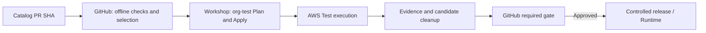

# Terragrunt Toolchain Automated Testing | High-Level Design

**Version:** 4.3 | **Status:** Architecture review draft | **Scope:** Phase 1, with Phase 2 boundaries

**Objective:** Validate an unreleased, generic Catalog toolchain revision against a representative four-account AWS Test organization before it becomes an approved version consumable by Runtime. This design builds on the existing Catalog, Workshop, GitHub Actions and AWS toolchain; it does not introduce a parallel deployment platform.

**Decision status:** **Agreed** = architectural direction accepted; **Preferred** = proposed design pending approval; **Open** = implementation or pilot evidence still required.

# 3. Solution

## 3.1 Architecture Overview

A Catalog PR triggers GitHub Actions, which owns the validation flow and final PR check. GitHub performs offline checks, selects AWS tests, invokes Workshop to deploy the exact PR candidate to `AWS/org-test`, starts the selected tests in the appropriate AWS execution context, collects results and initiates cleanup. The release path must retain a verifiable link to the tested revision.

The Test organization comprises **Toolchain, Dev, Staging and Prod** accounts, all dedicated to testing. Workshop retains separate `AWS/org-test` and `AWS/org-prod` hierarchies. Only `org-test` accepts an unreleased Catalog candidate. The Test environment models the customer toolchain topology; it is not an application-specific test environment.

| Component | Responsibility |
|---|---|
| **Catalog** | Candidate source, test definitions, mandatory suite, selection rules and test inventory |
| **GitHub Actions** | End-to-end orchestration, offline checks, selection, AWS invocation, result correlation and required gate |
| **Workshop `AWS/org-test`** | Candidate Plan/Apply/Destroy in the four Test accounts using the established deployment model |
| **Test Toolchain account** | Preferred location for trusted AWS test execution entry point and shared execution infrastructure |
| **Test Dev/Staging/Prod** | Deployed candidate resources and actual runner execution contexts where behavior must be tested in-account |
| **Golden Path repository** | Customer-like workload used by limited E2E tests; test ownership and selection remain in Catalog |
| **Runtime / `AWS/org-prod`** | Consumption of approved releases only; no candidate override |

## 3.2 Test Strategy and Selection

Phase 1 uses **ordered, fail-fast validation stages**. Offline checks execute before AWS deployment. Tests within a stage may run concurrently if their dependencies permit it.

| Stage | Execution | Selection |
|---|---|---|
| Static and IaC policy checks | GitHub Actions, without AWS deployment | Affected code; required |
| Applicable native/module checks | GitHub Actions, without AWS deployment | Affected units; required when applicable |
| Candidate Plan/Apply | Existing Workshop workflow in `org-test` | Required for every candidate |
| AWS integration and security checks | Approved AWS test execution contexts | Mandatory baseline **plus** rule-selected tests |
| Limited Golden Path E2E | Dedicated customer-like test repo, in Test accounts | Mandatory and rule-selected as defined in Catalog |
| Evidence, cleanup and final gate | GitHub plus trusted Test infrastructure | Required for every run that reaches the relevant stage |

GitHub evaluates the PR diff against **Catalog-owned central selection rules**, unions matching test IDs with the **mandatory baseline**, and resolves each ID against a versioned test inventory. The inventory identifies the required execution context: **central/API** or **actual target-account runner**. The resulting manifest pins the candidate SHA, selected test IDs, selection reasons and contexts. GitHub passes that manifest to the approved AWS execution path; tests are not discovered independently by each runner.

**Coverage invariant:** Unknown or broad-impact changes trigger conservative wider selection or fail the selection gate. Rule changes must be validated. Mandatory tests cannot be deselected by path rules. Dependency-graph Test Impact Analysis is deferred to Phase 2.

## 3.3 Candidate Deployment and Version Control

**Agreed:** Workshop deploys the **exact Catalog PR commit SHA** using a test-only source override in `AWS/org-test`. Today the normal source reference is derived from `catalog_version` in `account.hcl`; the candidate override must take precedence only for test deployment. `AWS/org-prod` and Runtime continue to consume approved release tags.

The candidate SHA is shared by selection, deployment, test execution and evidence. The existing Workshop deployment dependency order is retained: prerequisite environment roles, Toolchain orchestrator, then remaining Dev/Staging/Prod executor resources as needed. The exact override precedence and invocation wiring belong to LLD, but a pilot must prove that no stage silently falls back to the previously pinned tag.

## 3.4 AWS Test Execution

**Preferred, pending Security approval:** GitHub uses scoped OIDC authorization to invoke an approved standard CodeBuild execution entry point, waits for the **specific returned build ID**, and records its terminal result. If direct `StartBuild` cannot be approved, the existing authorized CodePipeline route is the fallback, with the same exact-execution result contract. GitHub remains the sole end-to-end orchestrator in both cases.

The **Test Executor** is a logical execution capability built from approved AWS infrastructure, **not** a new service, a CodeBuild project per test or a second workflow orchestrator. Two contexts are required:

- **Central/API:** Tests run from an approved execution context, preferably in the Test Toolchain account, with constrained access to the relevant Test accounts.
- **Target-runner:** Tests of runner IAM, network reachability or runtime behavior execute through the **actual Dev/Staging/Prod runner context under test**. A centrally assumed administrative role is not an equivalent test of that runner's effective permissions.

A selected test is dispatched to its declared context and returns correlated status, reports and logs. The exact cross-account dispatch mechanism and whether candidate-created runners can be used safely for all runner-context cases require LLD/pilot validation. Reusable projects are preferred over one project per test. No Step Functions dependency or CodeBuild-hosted GitHub Actions runner capability is assumed.

**Trust boundary:** GitHub dispatch configuration, permitted AWS projects/accounts/roles and security-sensitive build settings remain platform-controlled. PR-controlled test code and artifacts are untrusted and cannot choose arbitrary execution roles, change trusted dispatch or access actual production. Candidate execution permissions must be separate from privileged bootstrap and cleanup permissions.

## 3.5 Test Environment Lifecycle

**Agreed principle:** **Persistent Foundation + Ephemeral Candidate.** Keep account bootstrap, hub-and-spoke networking and the minimum trusted execution, state, evidence and cleanup capability necessary to operate the Test organization. Deploy candidate-owned toolchain resources and Golden Path workloads for validation, then destroy the entire **candidate-owned scope** after each run, including failures and cancellations.

The foundation must remain independently operable when candidate Apply fails or candidate resources are removed. In particular, a candidate cannot delete the only mechanism capable of completing its Destroy. Candidate cleanup must never target shared VPCs, LZA prerequisites or unrelated resources. Runs are serialized initially, with safeguards for retries and orphan recovery.

**Open:** Exact foundation/candidate resource boundary, Terraform state ownership, partial-Apply recovery and budget feasibility. These are LLD and pilot decisions; the architecture retains the full candidate-teardown objective unless a measured constraint requires review.

## 3.6 Results, Evidence and Release Gate

GitHub publishes one authoritative **required PR check**. It must wait for terminal outcomes of the exact Workshop and AWS executions, retain the original failure reason, and report cleanup status independently. Unknown, missing or timed-out required results fail closed. A cleanup failure cannot yield a passing final gate.

**Agreed principle:** Persist a per-run evidence record **outside candidate teardown**, including candidate SHA, selection manifest, deployment/build IDs, test results, execution identity, diagnostics, cleanup outcome and release linkage. Encrypted, access-controlled S3 archival with lifecycle tiers is the preferred approach. Evidence is retained for every run, including failures; indefinite availability of essential evidence does not require indefinite hot retention of raw CloudWatch logs. Exact storage location, retention classes and policy are open for implementation.

A PR check proves only the revision it tested. If merge or `release-please` produces a different commit SHA, the release process must establish approved equivalence or rerun required validation. Runtime consumes only versions backed by accepted validation provenance. Enforcement wiring is open for LLD.

## 3.7 Phase Boundaries

| Phase 1 | Potential Phase 2 |
|---|---|
| Mandatory AWS suite + central path rules | Dependency-aware Test Impact Analysis |
| Change-scoped offline checks | More advanced impact analysis |
| Integration and limited Golden Path E2E | Broader E2E and negative-path coverage |
| Operational candidate teardown after every run | Explicit update, idempotency and Destroy-behavior test cases |

# 4. Alternatives Considered

| Decision area | Alternatives | Direction and rationale |
|---|---|---|
| Orchestration | GitHub-led vs AWS-led pipeline | **GitHub-led (Agreed):** integrates directly with PR checks and existing Workshop workflow; avoids a second end-to-end orchestrator |
| AWS invocation | Direct CodeBuild vs existing CodePipeline | **Direct CodeBuild (Preferred):** simpler for selected test batches; **CodePipeline fallback** if authorization constraints prevent it |
| Test placement | All tests central vs per-account execution | **Two contexts (Agreed):** central for API checks; genuine target runner for behavior dependent on its identity/network |
| Selection | Full suite only vs rules only vs hybrid | **Hybrid (Agreed):** mandatory coverage plus change-specific tests; conservative fallback limits missed impact |
| Environment | Always-on candidate vs full recreation | **Persistent foundation + ephemeral candidate (Agreed principle):** cost control and isolation without deleting essential bootstrap infrastructure |
| Test ownership | Separate tests repository vs Catalog-owned definitions | **Catalog-owned definitions (Agreed):** tests version with candidate; separate Golden Path workload repository for E2E |

# 5. Security, Cost and Operations

**Security:** Limit candidate SHA overrides to `org-test`; constrain GitHub OIDC and AWS execution targets; isolate untrusted PR test payload from trusted dispatch, privileged bootstrap and cleanup; preserve Dev versus Staging/Prod trust boundaries. Runner permission tests must use the effective runner identity, not an elevated substitute. Actual production access is outside the testing trust boundary.

**Cost:** Keep shared networking and minimal execution foundation persistent; remove candidate-owned compute and toolchain resources after each run. Apply evidence storage lifecycle policies. Establish cost/runtime budgets from pilot measurements rather than assumed figures.

**Operations:** GitHub is the status authority; AWS logs and structured reports are the diagnostic source. Every stage is correlated by candidate SHA, GitHub run and exact AWS execution ID. Cleanup and orphan recovery need a trusted path independent of candidate health. Workshop, Catalog and Security ownership must be agreed before enforcement.

**Dependencies:** LZA-provisioned accounts and roles, shared hub/spoke VPCs and subnets, regional enablement, platform-deployment access, and shared CodeConnection where applicable. These are prerequisites, not candidate-created resources.

# 6. Key Risks and Mitigations

| Risk | Impact | Architectural mitigation |
|---|---|---|
| Wrong Catalog revision deployed | False validation | Test-only SHA override; verify SHA consistently across manifest, Workshop and execution |
| PR payload gains privileged execution control | Cross-account exposure | Trusted dispatch separate from untrusted tests; allowlisted contexts and roles |
| Central test falsely represents runner permissions | Invalid security result | Execute runner-specific checks in the genuine target-runner context |
| Test selection misses a shared dependency | Regression escapes | Mandatory baseline and conservative fallback for uncertain impact |
| AWS failure does not reach GitHub | Incorrect PR approval | Wait on exact execution ID; fail closed on missing/unknown result |
| Candidate Destroy removes its own cleanup path | Orphans, cost and broken runs | Independent foundation, protected state and recovery authority |
| Evidence disappears on teardown | Unverifiable release | Durable external evidence archive and SHA-to-release linkage |
| Candidate cost/runtime exceeds budget | Unsustainable validation | Pilot measurement, serial execution initially and explicit cost thresholds |

# 7. Pilot and Rollout

**Pilot:** One internal Workshop test project across the four Test accounts. Prove exact-SHA deployment, mandatory plus rule-selected tests, central/API execution, one actual runner-context test, limited Golden Path E2E, failure propagation, candidate teardown and retained evidence.

**Preconditions:** Security-approved execution route or authorized fallback; feasible runner-context invocation; protected cleanup foundation; test-only override; known account/network prerequisites.

**Stop criteria:** SHA mismatch; failed AWS test shown as GitHub success; uncontrolled permissions; runner identity cannot be proven; shared resources destroyed; persistent candidate orphans; missing evidence; or unacceptable measured cost/runtime. Roll out required checks and release enforcement only after the pilot demonstrates these invariants.

# 8. Decisions, Open Items and ADR Candidates

## 8.1 Decisions and Status

| Topic | Status |
|---|---|
| GitHub as end-to-end orchestrator and PR gate | **Agreed** |
| Offline-first, mandatory + rule-selected AWS tests | **Agreed** |
| Catalog-owned tests and central selection rules | **Agreed** |
| Workshop `org-test` deploys exact candidate SHA; production remains tag-pinned | **Agreed principle** |
| Four-account customer-like Test organization | **Agreed** |
| Central/API plus genuine target-runner execution contexts | **Agreed requirement** |
| Direct scoped OIDC `StartBuild`; existing CodePipeline fallback | **Preferred, approval pending** |
| Persistent foundation, full candidate-owned teardown | **Agreed principle; boundary open** |
| Durable evidence, fail-closed gate and release provenance | **Agreed principle; enforcement open** |
| Dependency-aware selection and lifecycle test cases deferred | **Agreed Phase 2 boundary** |

## 8.2 Open Items

| Open item | Needed before |
|---|---|
| Security approval of direct `StartBuild` or confirmation of CodePipeline fallback | AWS execution implementation |
| Feasible, correlated dispatch into the **actual** candidate runner contexts | Pilot acceptance |
| Exact persistent foundation versus candidate resource inventory and state/cleanup ownership | Lifecycle LLD and cost approval |
| Workshop SHA override precedence and exact invocation/result linkage | Pilot |
| Approved initial mandatory tests, path rules and conservative fallback | Pilot |
| Durable evidence destination, retention tiers and diagnostics policy | Pilot enforcement |
| Tested SHA to release-please/tag equivalence or revalidation enforcement | Release gate enforcement |
| Cost, duration and recovery thresholds | Pilot exit |

These items **do not block the HLD concept**. They require explicit owner approval or pilot proof before implementation/enforcement, and should not be silently treated as completed decisions.

## 8.3 Proposed ADR Groups

1. **Validation orchestration and AWS execution:** GitHub-led control, direct CodeBuild versus CodePipeline fallback, execution contexts.
2. **Selection and coverage:** Mandatory baseline plus path rules, conservative fallback, Phase 2 TIA.
3. **Candidate and release provenance:** Test-only SHA injection, immutable run identity, Runtime release gate.
4. **Environment lifecycle and isolation:** Four-account topology, persistent foundation, full candidate teardown and recovery.
5. **Security and evidence:** Trusted dispatch boundary, genuine runner testing, durable evidence and fail-closed status.

## 8.4 Review and Approval

| Review | Stakeholders |
|---|---|
| Catalog validation and coverage | Catalog / Platform owners |
| Workshop candidate injection and lifecycle | Workshop / Platform owners |
| OIDC, execution roles and cross-account security | Security / Platform |
| Release evidence and Runtime gate | Release / Runtime owners |
| Pilot reliability, budget and recovery | Platform Operations |

---

**Document basis:** Prior HLD v4.2, the established Catalog/Workshop topology, supplied architecture screenshots and the agreed project decisions. This is an internal solution design; AWS and GitHub service behavior is intentionally not explained beyond its architectural role.

**Implementation references:** [GitHub OIDC for AWS](https://docs.github.com/en/actions/how-tos/secure-your-work/security-harden-deployments/oidc-in-aws) · [CodeBuild StartBuild](https://docs.aws.amazon.com/codebuild/latest/APIReference/API_StartBuild.html) · [CodeBuild test reports](https://docs.aws.amazon.com/codebuild/latest/userguide/test-reporting.html)
