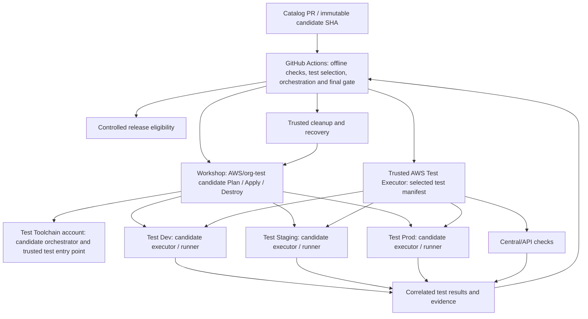

# Terragrunt Toolchain Automated Testing | High-Level Design

**Version:** 4.5  
**Status:** Architecture review draft  
**Scope:** Phase 1 architecture and explicit Phase 2 boundaries  
**Audience:** Platform/DevEx, Workshop, Catalog, Security, Release Engineering, Operations

**Objective.** Validate an **unreleased, generic Catalog toolchain candidate** in a customer-representative, dedicated four-account AWS Test organization before permitting an approved release to be consumed by Runtime. Reuse the existing GitHub, Workshop and AWS toolchain rather than building another deployment platform.

**Decision vocabulary:** **Agreed** means an accepted architectural principle; **Preferred** means a recommended approach subject to approval or proof; **Open** means a bounded decision or implementation detail not yet resolved. A proposed mechanism is not described as deployed or verified.

# 3. Solution

The solution validates an unreleased Catalog toolchain revision **before** it is approved for use by Runtime. A Catalog pull request triggers a GitHub Actions validation workflow that first performs AWS-independent checks, then selects the required AWS tests, deploys the exact candidate revision through Workshop into the dedicated four-account Test organization, executes the selected tests, and consolidates evidence into a required PR gate.

**GitHub Actions remains the single end-to-end orchestrator.** Catalog owns the test definitions and selection policy; Workshop owns the established Terragrunt deployment process; AWS CodeBuild provides the preferred reusable execution capability for tests that require AWS. The test environment models a customer's Toolchain, Dev, Staging and Prod accounts, but is isolated from real production. Candidate-owned infrastructure is removed after each run while the minimal trusted foundation and durable evidence remain available.

Phase 1 combines **mandatory tests with change-based selection rules**. It does not require a new AWS orchestration platform, a CodeBuild project for every test, or dependency-graph Test Impact Analysis. The key design principle is to execute each test in the context that makes its result valid: central/API checks from a constrained central executor, and runner-behavior checks through the actual candidate runner identity and network context.

The sections below define the component responsibilities, ordered validation flow, test-selection contract, AWS execution model, candidate provenance, lifecycle and release controls. The exact AWS dispatch wiring, cleanup resource inventory and IAM implementation are intentionally left to LLD and pilot validation where noted.

## 3.1 System Context and Ownership

The Catalog repository contains the candidate toolchain source, test definitions, mandatory tests, versioned selection rules and test metadata. GitHub Actions is the end-to-end orchestrator and authoritative PR gate. Workshop owns the deployment workflow and the `AWS/org-test` Terragrunt hierarchy, separately from `AWS/org-prod`. The Test organization has four dedicated accounts: **Toolchain, Dev, Staging and Prod**. These accounts emulate the customer toolchain topology; none is a real production account. Runtime consumes approved Catalog releases, not PR candidates.

The Toolchain Test account is the **preferred** home for trusted test-dispatch and result-collection infrastructure. Tests requiring the effective identity or network path of a candidate runner execute in the relevant Dev, Staging or Prod runner context. A separate Golden Path repository supplies a customer-like workload for limited E2E testing; it does not become the owner of the toolchain test suite.

**Architectural separation:** GitHub decides **what** to validate and whether the PR passes. Workshop decides **how the candidate is deployed**. The AWS execution layer decides **where a selected test runs**, based on a trusted execution-context mapping. Candidate-controlled code cannot redefine those boundaries.

## 3.2 End-to-End Validation Flow

1. **Identify the candidate.** On a Catalog PR update, GitHub records the exact candidate commit SHA and a unique run identifier. A superseded run cannot approve a newer SHA.
2. **Run offline checks and select AWS tests.** GitHub runs applicable static, policy and native checks without deploying AWS resources. It builds a test manifest from the mandatory baseline and change-based rules. Any required offline failure blocks deployment.
3. **Deploy the candidate in `org-test`.** GitHub invokes the existing Workshop workflow with a test-only candidate SHA override. Workshop performs Plan/Apply across the four Test accounts in the required dependency order. Deployment must prove the actual source revision used.
4. **Execute selected AWS tests.** GitHub invokes the trusted AWS Test Executor with the immutable manifest and candidate identity. The executor runs central/API checks and routes runner-context checks to the **actual candidate runner** in the specified Test account. The invocation mechanism is described in §3.4.
5. **Collect results and evidence.** The exact AWS execution IDs, structured test results and diagnostic references are returned to GitHub and archived outside the candidate scope. Missing, ambiguous or timed-out required results are failures.
6. **Clean up and decide.** Trusted cleanup destroys candidate-owned resources even after a test failure, subject to a recovery path for interrupted runs. GitHub publishes one required, fail-closed result; cleanup failure is independently visible and blocks approval. Only a validated revision can proceed toward controlled release.

The normal first-time toolchain deployment order remains **environment prerequisite roles → Toolchain orchestrator → remaining environment executor stacks**. Required accounts, LZA roles, network and regional prerequisites must exist before this sequence begins.

## 3.3 Test Strategy and Selection

Validation follows an **ordered, fail-fast stage model**, as in v3. Independent checks within a stage may execute in parallel; a failed required stage prevents subsequent deployment or testing. Cleanup and evidence collection still run when needed after a failure. GitHub records the result of each required stage rather than treating a successfully started AWS build as a successful test.

**Phase 1 selection model: mandatory baseline + central change-based rules.** This is intentionally simpler than dependency-graph Test Impact Analysis.

| Validation layer | Selection principle | Execution boundary |
|---|---|---|
| Static / format / configuration checks | Required, scoped to changed applicable files | GitHub Actions; no AWS deployment |
| IaC policy and security checks | Required for affected IaC; conservative scope for shared configuration | GitHub Actions; no AWS deployment |
| Native/module tests | Required when relevant modules change | GitHub Actions; no AWS deployment |
| AWS integration and security checks | Always-run baseline **union** tests selected by Catalog rules | AWS Test organization |
| Limited Golden Path E2E | Required baseline plus applicable rule-selected scenarios | Customer-like workload in AWS Test organization |

The offline stage order is: **static/configuration validation → IaC security and policy compliance → applicable native/module validation → AWS test selection**. Once those stages pass, Workshop performs **Plan → Apply** before **AWS integration → limited Golden Path E2E**. AWS tests are selected before deployment but cannot execute until their required candidate resources are ready. This ordering preserves the v3 failure boundaries without prescribing individual tools or commands.

A **Catalog-owned, versioned test inventory** associates each test ID with its coverage area, execution context (`central/api` or `target-runner`), target environment(s), prerequisites and result contract. A **central rules file** maps changed components or paths to test IDs. The selector creates an immutable manifest containing candidate SHA, rule revision, selected test IDs, reasons and approved execution contexts. The trusted executor consumes this manifest; individual CodeBuild projects do not independently infer which tests should run.

For example, a change to a runner IAM component selects its applicable security checks in addition to mandatory tests. A check asserting that a Dev runner **cannot** access a protected Staging resource must execute as the real Dev runner identity, not via a privileged cross-account role. A central/API test may instead use a narrowly scoped inspection role. A shared or unclassified change expands selection conservatively or fails the selection stage. Mandatory tests cannot be suppressed by a path rule.

**Scope guard:** Phase 1 validates a fixed core suite and explicit change mappings. Sophisticated dependency-graph selection, broad E2E and dedicated update/idempotency/destroy-behavior tests are deferred to Phase 2. Operational cleanup is still mandatory in Phase 1 and is not the same as a lifecycle test case.

## 3.4 AWS Test Execution Model

**Recommended logical design:** One trusted **Test Executor capability**, preferably located in the Test Toolchain account, coordinates selected test batches using a **small reusable set of standard CodeBuild execution projects**, rather than a CodeBuild project per test. CodeBuild is the execution substrate, not a second end-to-end orchestrator. A CodePipeline-based entry path remains an authorized alternative if direct CodeBuild invocation is not approved.

**Invocation:** GitHub requests a specific execution, supplies or references the pinned manifest and candidate SHA, captures the returned execution/build identifier, waits for that exact execution to terminate, and imports its status. **Preferred:** tightly scoped GitHub OIDC permission for `StartBuild` on an allowlisted Test Executor project. **Fallback:** an approved CodePipeline invocation with equivalent immutable-input and exact-execution-result guarantees. Existing CodeConnections and EventBridge source triggers may remain in the Workshop deployment path; they do not by themselves provide reliable end-to-end GitHub test-result propagation.

**Execution contexts:**

- **Central/API checks:** The Test Executor runs checks using narrowly scoped, explicitly approved read or test permissions in the Test accounts. These checks can inspect APIs, deployed resources and cross-account behavior where the test does not depend on the candidate runner's own effective identity.
- **Target-runner checks:** The Test Executor dispatches a selected scenario to the existing **candidate-created CodeBuild runner project in the target Dev, Staging or Prod account**. That project runs the test under its actual candidate IAM role and VPC/network context. The dispatcher may start the project through approved cross-account permissions, but **must not replace its runtime identity with an administrator role**. The trusted execution plan fixes the allowed project, account, environment and test ID; a PR cannot nominate arbitrary projects or roles.

**Test payload:** Catalog owns the versioned test definitions. A reusable execution wrapper can be platform-owned, while the approved scenario/payload is resolved by test ID and candidate revision. The existing fixed buildspec paths with repository-supplied commands are relevant to the current toolchain, but do **not** justify allowing arbitrary PR commands to execute with privileged dispatch or cleanup permissions. The trusted dispatch path and untrusted candidate/test payload must be isolated.

**Reporting contract:** Every selected test yields a correlated terminal status and structured report, including the candidate SHA, test ID, target account/context, execution ID and diagnostic links. CodeBuild native test reports and CloudWatch logs are suitable AWS-side sources; GitHub publishes the consolidated PR outcome. **Open for LLD/pilot:** the precise cross-account dispatch/wait implementation, runner availability during partial Apply, buildspec/payload packaging, and the minimal IAM grants required. The pilot must prove a real negative-permission test from a candidate runner.

## 3.5 Candidate Revision Injection and Deployment Integrity

**Agreed principle:** Workshop deploys the **exact Catalog PR commit SHA**, not the currently approved release tag, only under `AWS/org-test`. Today `account.hcl` pins `catalog_version`, which is converted to a `toolchain-vX.Y.Z` source reference. A test-only override must take precedence for the candidate deployment without modifying production's version-pinning contract. `AWS/org-prod` and Runtime never accept the candidate override.

The SHA is carried through selection, Workshop Plan/Apply, test execution, evidence and release provenance. Workshop must expose sufficient evidence to verify the source it actually used. If the deployment resolves a different revision or silently falls back to `catalog_version`, the gate fails. The override's exact interface, precedence and validation are LLD/pilot matters.

## 3.6 Test Environment Lifecycle and Cost Boundary

**Agreed principle:** **Persistent Foundation + Ephemeral Candidate**. Preserve the LZA-provisioned four accounts, hub-and-spoke VPC/subnets, regional prerequisites, bootstrap roles, and the minimum trusted state, dispatch, evidence and recovery infrastructure needed when no candidate is deployed. Candidate-owned Toolchain and Dev/Staging/Prod resources and the Golden Path workload are created for a run and fully destroyed after it, including failed or canceled runs.

The foundation must be independently operable after a partial Apply and after candidate Destroy. Cleanup must be driven by trusted infrastructure and must not depend on a candidate runner that cleanup itself deletes. Run concurrency is serialized initially; each run has an explicit ownership identifier, a protected cleanup scope and orphan-recovery handling. A failed Destroy remains a blocking operational failure, not a silent success.

**Open:** Exact persistent-versus-ephemeral resource inventory, location and ownership of state buckets, recovery from partial Apply, and whether full teardown is economical within the pilot budget. Prefer keeping the foundation minimal, but do not make the teardown policy contingent on assumptions about unmeasured costs.

## 3.7 Evidence, PR Gate and Release Provenance

**Agreed principle:** A durable evidence record exists for **every attempted validation run**, including failed and interrupted runs, and is stored outside the candidate teardown scope. It includes the candidate SHA, selector inputs and manifest, Workshop execution/source evidence, AWS build IDs, test results, execution identities, failure diagnostics, cleanup result and release association.

**Preferred storage model:** Encrypted, access-controlled S3 archive in a trusted account with durable per-run manifests and reports; apply lifecycle storage tiers to larger raw diagnostics. Retain essential release evidence indefinitely as requested, subject to organizational retention policy. Raw CloudWatch logs need not remain in expensive hot storage indefinitely if complete required diagnostics are exported and integrity can be verified. Final retention classes, archival location and access policy are LLD/operations decisions.

GitHub's **required check** must wait for exact terminal deployment/test/cleanup outcomes, fail closed on missing evidence or timeouts, and display the failure stage separately from cleanup status. A PR check proves only the exact SHA tested. If merging or release automation creates a different SHA, the release process must prove approved equivalence or rerun validation. Runtime may consume only approved releases backed by accepted evidence. The enforcement mechanism is open for implementation.

## 3.8 Phase 1 / Phase 2 Boundary

| Phase 1 commitment | Phase 2 candidate |
|---|---|
| Mandatory AWS tests plus central path/component rules | Dependency-aware Test Impact Analysis |
| Changed-scope offline checks | More advanced impact selection |
| Integration, negative security checks and limited Golden Path E2E | Broader E2E and failure-mode coverage |
| Full candidate teardown as an operational requirement | Dedicated update, idempotency and destroy-behavior test cases |

# 4. Alternatives and Rationale

| Decision | Options considered | Direction and reason |
|---|---|---|
| End-to-end control | GitHub-led; AWS-led CodePipeline | **GitHub-led (Agreed):** preserves the Catalog PR gate and Workshop ownership without duplicating orchestration |
| AWS invocation | Scoped direct CodeBuild; CodePipeline entry | **Direct CodeBuild (Preferred):** lightweight selected-test execution; **CodePipeline fallback** if security policy prevents direct invocation |
| AWS execution placement | Central-only; one project per test; reusable central and target-runner contexts | **Reusable dual-context model (Preferred):** scales test inventory while preserving genuine runner identity/network testing |
| Test selection | Always full suite; rules only; mandatory + rules | **Mandatory + rules (Agreed):** bounded Phase 1 cost with conservative coverage |
| Test ownership | Dedicated test-code repository; Catalog-owned tests | **Catalog-owned definitions (Agreed):** test behavior versions with the candidate; Golden Path repo models a customer workload |
| Environment | Always-on deployed toolchain; full teardown including foundation; persistent foundation + ephemeral candidate | **Hybrid lifecycle (Agreed principle):** isolation and cost control without destroying recovery prerequisites |
| Candidate source | Test released tag; temporary candidate tag; SHA override | **SHA override in org-test (Agreed principle):** validates the actual PR content without weakening Runtime's release pin |

# 5. Security, Cost and Operations

This section captures the operational and trust requirements of the proposed architecture. Detailed policies, account-specific IAM statements, subnet selection and lifecycle automation belong to LLD.

## 5.1 Security and Trust Boundaries

**Security boundaries.** Test accounts are isolated from real production. `org-test` is the only hierarchy permitted to resolve unreleased Catalog SHAs. The GitHub-to-AWS execution principal may invoke only allowlisted Test projects and cannot freely override privileged build configuration, roles, source or network settings. A trusted dispatcher validates the manifest and environment mapping. Candidate-controlled commands run only with the permissions appropriate to the candidate runner or constrained test context. Bootstrap, teardown, evidence and release approval permissions remain separate. Preserve the existing untrusted Dev versus trusted Staging/Prod boundary, including restrictions on reading trusted logs or artifacts.

## 5.2 Cost and Resource Efficiency

**Operations and cost.** Persist only the foundation needed to start, observe and recover runs. Destroy candidate resources after every run; enforce timeout, retry and orphan-recovery policies. Serialize Phase 1 runs and measure AWS spend, end-to-end duration, cleanup reliability and evidence volume during the pilot. Do not set cost targets without measured baseline data.

## 5.3 Operations and Observability

GitHub owns the authoritative PR status; AWS build logs, structured reports and archived execution evidence provide diagnostics. Every run is correlated to its Catalog SHA, GitHub run ID, Workshop execution and AWS build IDs. Cleanup failures and orphaned resources require an independent recovery path.

## 5.4 Platform Dependencies

**Dependencies.** LZA accounts and `iac-admin-role`, hub-and-spoke VPCs and tagged compute subnets, region enablement, relevant egress paths, platform-deployment access, and shared CodeConnection where applicable pre-exist the candidate. Their readiness is a deployment prerequisite, not part of candidate teardown.

# 6. Risks and Architectural Controls

| Risk | Consequence | Control / required proof |
|---|---|---|
| Workshop deploys the pinned release instead of the PR SHA | False validation | Candidate SHA source evidence; mismatch fails closed |
| Untrusted PR controls dispatch or privileged build settings | Cross-account compromise | Trusted allowlisted executor and strict role separation |
| Central API check substitutes for actual runner permissions | False security confidence | At least one verified target-runner negative test in pilot |
| Rules miss a shared dependency | Untested regression | Mandatory baseline, conservative selection fallback |
| AWS failure is not reflected in GitHub | Unsafe merge | Wait for exact execution ID and terminal result |
| Cleanup deletes its own recovery path or shared network | Stranded resources / outage | Independent protected foundation and scoped Destroy |
| Partial Apply leaves costly resources | Orphans / unexpected spend | Run ownership, cleanup on failure and recovery workflow |
| Evidence is lost or mismatched to release | Unverifiable approval | Durable external archive and SHA-to-release provenance |
| Test execution model cannot fit security policy | Pilot blocked | Preapprove constrained StartBuild or CodePipeline fallback |

# 7. Pilot and Rollout

## 7.1 Pilot Scope

Run one internal Workshop project in the four-account Test organization. The pilot must demonstrate: (1) exact Catalog PR SHA injection and verification; (2) offline and mandatory-plus-rule selection; (3) central/API test execution; (4) a negative-permission test under an **actual Dev candidate runner**; (5) limited Golden Path E2E; (6) exact AWS failure propagation to GitHub; (7) full candidate-owned cleanup after both success and failure; and (8) durable evidence independent of teardown.

## 7.2 Readiness and Stop Criteria

**Pre-pilot gates:** Accounts/network/bootstrap ready; test-only override design approved; direct CodeBuild authorization or CodePipeline fallback approved; independent cleanup path available; initial suite/rules reviewed. **Abort or hold rollout:** SHA mismatch, unexpected privileged access, false GitHub success, inability to prove runner identity, shared-resource deletion, unbounded orphans, missing evidence, or unacceptable measured cost/duration. Enable mandatory merge/release enforcement only after the pilot validates these invariants.

## 7.3 Rollout Approach

Begin with one internal Workshop project and serialized Catalog candidate validation. Expand the selected test inventory and enforce merge/release controls only after the pilot demonstrates safe execution, accurate status propagation, recoverable teardown and acceptable measured cost. Later expansion must preserve the four-account trust model and the same test-manifest contract.

# 8. Decision Register, Open Items and ADR Candidates

## 8.1 Current Decisions

| Topic | Status |
|---|---|
| GitHub Actions owns orchestration and final PR gate | **Agreed** |
| Four-account customer-like AWS Test organization | **Agreed** |
| Workshop has separate `AWS/org-test` and `AWS/org-prod` trees | **Agreed** |
| Offline-first checks and mandatory + rule-selected AWS tests | **Agreed** |
| Catalog owns test definitions, inventory and selection rules | **Agreed** |
| Test-only exact-SHA candidate injection | **Agreed principle; implementation open** |
| Central/API and actual target-runner contexts | **Agreed requirement; dispatch design open** |
| Trusted Test Executor using reusable CodeBuild execution | **Preferred; pilot/security proof pending** |
| Scoped OIDC `StartBuild` with CodePipeline fallback | **Preferred; approval pending** |
| Persistent foundation and full candidate-owned teardown | **Agreed principle; inventory and cost open** |
| Durable evidence, fail-closed PR check and release provenance | **Agreed principle; enforcement open** |
| Advanced dependency-aware selection and dedicated lifecycle tests | **Deferred to Phase 2** |

## 8.2 Open Items and Their Decision Boundary

| Open question | HLD impact | Resolution point |
|---|---|---|
| Can Security approve scoped GitHub OIDC `StartBuild`? | Does **not** change GitHub-led architecture; CodePipeline is fallback | Security review before pilot |
| How is a selected test dispatched to the actual candidate CodeBuild runner and awaited? | **Core feasibility proof** of dual-context design | LLD and pilot |
| Which exact resources and state belong to foundation vs candidate? | Does not change lifecycle principle; affects safe teardown and cost | LLD inventory and pilot |
| How does Workshop override and verify the Catalog SHA? | Does not change candidate principle; wrong behavior invalidates gate | LLD and pilot |
| What is the initial mandatory test inventory and rule mapping? | Needed for measurable coverage, not for architectural structure | Pilot planning |
| Where are archives stored, and what raw-log tiers are retained? | Evidence principle fixed; operations policy open | LLD / Operations |
| How is tested SHA equivalence enforced across merge/release-please/tag? | Release provenance principle fixed; exact gate open | Release Engineering LLD |
| What are acceptable cost, duration and orphan-recovery thresholds? | May force lifecycle trade-off review if pilot fails | Pilot exit review |

**HLD readiness:** The architecture is reviewable with these items explicitly open. It is **not yet implementation-approved**: the runner-context dispatch and cleanup independence require pilot proof, and the AWS invocation path requires security authorization.

## 8.3 Consolidated ADR Topics (to write separately, later)

1. **Orchestration and execution:** GitHub-led gate, reusable CodeBuild execution, target-runner dispatch and CodePipeline fallback.
2. **Selection and test ownership:** Catalog-owned inventory/rules, mandatory baseline, change-scoped checks and Phase 2 TIA.
3. **Candidate and release provenance:** Test-only SHA override, revision verification and approved-version consumption.
4. **Test environment lifecycle:** Persistent foundation, ephemeral candidate, state/cleanup independence and cost controls.
5. **Security and evidence:** Trusted versus untrusted execution, runner identity proof, durable evidence and fail-closed gating.

## 8.4 Review Ownership

| Review area | Accountable participants |
|---|---|
| Test selection, suite and Catalog changes | Catalog / DevEx |
| Workshop SHA injection, deployment and teardown | Workshop / Platform |
| Cross-account invocation, runner context and IAM boundary | Security / Platform |
| Release evidence and Runtime admission | Release Engineering / Runtime |
| Cost, monitoring and orphan recovery | Platform Operations |

---

**Document basis:** Compared HLD v3 and v4.4, preserving v3 explanatory structure and v4.4 architectural decisions; reviewed HLD v4.3 and the supplied architecture decisions and screenshots. Specific AWS implementation mechanisms remain proposals until verified in the organizational environment.

**Technical references:** [GitHub OIDC with AWS](https://docs.github.com/en/actions/how-tos/secure-your-work/security-harden-deployments/oidc-in-aws) · [AWS CodeBuild StartBuild API](https://docs.aws.amazon.com/codebuild/latest/APIReference/API_StartBuild.html) · [AWS CodeBuild test reporting](https://docs.aws.amazon.com/codebuild/latest/userguide/test-reporting.html) · [AWS CodePipeline execution API](https://docs.aws.amazon.com/codepipeline/latest/APIReference/API_StartPipelineExecution.html)
